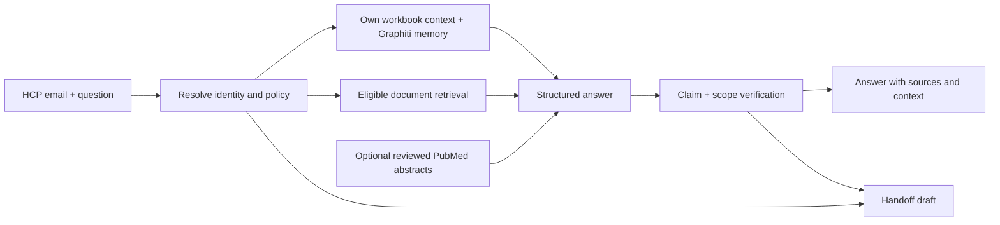

# CAMZYOS Contextual Rep

A Streamlit prototype for personalized CAMZYOS information for HCPs in Germany. It combines the supplied HCP workbook, Graphiti memory, and separately controlled document retrieval. Every generated clinical claim must reference retrieved evidence; unsupported requests produce a handoff draft.

**New to the product?** Start with the [product flow and Streamlit walkthrough](docs/product-walkthrough.md):
what happens before/during chat, what each view does, and a five-minute demonstration sequence.

**Current state:** runnable locally, with deterministic tests and live source checks. Add your API key for generation, embeddings, Graphiti extraction and RAGAS scoring. No live answer-quality improvement is claimed yet. See [verification and limitations](docs/status.md).

**All-PDF testing:** all eight PDFs now have a separate inspection vector index: 432 passages across 203 pages. Open **Sources & updates → All-PDF testing index**, or run `python -m camzyos.cli index-all` followed by `python -m camzyos.cli doctor --strict --all-documents`. This supports testing excluded/staged documents without authorizing them for clinical answers. [Commands, code map and coverage](docs/all-pdf-testing.md).

## Clone and run

Conversation history is retained with timestamps; automatic summaries only compact the model's working
context. Clear/forget controls remain explicit user actions, and persistence remains opt-in. Clinical
retrieval now reranks up to 20 eligible candidates before selecting six passages. See
[conversation retention, consent and reranking](docs/conversation-and-reranking.md) for settings and limits.

**The inputs are included in Git:** [assets/hcp_context.xlsx](assets/hcp_context.xlsx) is the original workbook, and [assets/product_information](assets/product_information) contains all seven supplied PDFs plus the downloaded German Fachinformation. You do not need the original Desktop/Downloads folders. See [asset provenance and workbook usage](assets/README.md).

Install **Git** and **Python 3.13**. For the Docker database option, also install and start **Docker Desktop** on Windows/macOS, or Docker Engine with Compose on Linux. Windows users can instead use the included database helper below. No Neo4j cloud account or knowledge of graph queries is needed. This repo is private, so collaborators need GitHub access before cloning:

```shell
git clone https://github.com/aribakhtar/camzyos-contextual-rep.git
cd camzyos-contextual-rep
```

On Windows PowerShell:

```powershell
py -3.13 -m venv .venv
.\.venv\Scripts\Activate.ps1
python -m pip install -c requirements.lock -e '.[dev,eval]'
Copy-Item .env.example .env
```

On macOS/Linux:

```bash
python3.13 -m venv .venv
source .venv/bin/activate
python -m pip install -c requirements.lock -e '.[dev,eval]'
cp .env.example .env
```

Create `.env` only on a fresh clone; preserve an existing file containing your key. Set `OPENAI_API_KEY` and a `NEO4J_PASSWORD` of at least eight characters. Input paths already default to the committed assets in `config.yaml`; optional `.env` overrides can be relative to the repository root or absolute.

| Setting | What to enter |
|---|---|
| `OPENAI_API_KEY` | Your model API key; generation, embeddings, memory extraction and evaluation use it. |
| `NEO4J_PASSWORD` | A password you choose for your local database before its first setup. It is not an API key. |
| `NEO4J_URI`, `NEO4J_USER`, `NEO4J_DATABASE` | Leave the supplied defaults for the local database. |
| `NCBI_API_KEY` | Optional key for higher PubMed API request limits. Leave blank for this prototype. |
| `NCBI_EMAIL` | Optional developer contact email included in PubMed requests to NCBI; not an HCP email or email account password. |
| `WORKBOOK_PATH`, `PDF_DIR` | Leave blank to use the workbook and PDFs already in `assets/`. |

PubMed search is **off by default** (`pubmed_enabled: false` in `config.yaml`). It can make low-volume requests without an NCBI key; see [NCBI's API key explanation](https://ncbiinsights.ncbi.nlm.nih.gov/2017/11/02/new-api-keys-for-the-e-utilities/). Enabling discovery does not approve articles for clinical answers: those require the reviewed-PMID allowlist. The core PDF/workbook chatbot needs neither NCBI field.

**Neo4j is the local database** holding Graphiti's HCP memory graph and document search vectors. Graphiti builds and queries the memory; the application creates the database indexes. You do not need to create nodes manually. SQLite holds the source registry and consented chat records in the generated `data/` folder.

Start Neo4j with Docker Compose (Windows/macOS/Linux), or point `.env` at an existing Neo4j instance. The following command downloads the configured database image on its first run, creates the local database, and runs it in the background:

```shell
docker compose up -d
```

On Windows without Docker, the included helper is an alternative:

```shell
python scripts/local_neo4j.py setup
python scripts/local_neo4j.py start
```

Use one database option. The helper keeps Java/Neo4j under ignored `.runtime/`, with no Windows service or global Java changes. Docker uses a local named volume. Wait until the following doctor command reports `neo4j_connected: true` before syncing/seeding.

From the activated environment, prepare the document index **before starting chat**:

```shell
python -m camzyos.cli build
python -m camzyos.cli index-all
python -m camzyos.cli doctor --strict --all-documents
python -m camzyos.cli seed
python -m streamlit run app.py
```

`build` parses/chunks the bundled PDFs, restores only the exact version in [the recorded prototype review](assets/demo_review.json), embeds it and verifies the complete index. Changed/new versions remain staged for review; previously withdrawn versions are not restored. Prototype eligibility is not sponsor approval. `prepare` is the optional offline parsing step only; it does **not** make chat ready. `ingest --source SOURCE_ID --file path/to/replacement.pdf` parses, chunks and indexes a replacement while keeping it staged. Reviewed activation checks indexing before switching the active version.

`sync` repairs/rebuilds the active document index if needed. `seed` imports the eight supplied HCP contexts into isolated Graphiti groups. Indexing and seeding use the configured API and incur usage; unchanged embeddings and an unchanged seed are reused. Open http://127.0.0.1:8501 and use `anna.weber@example-clinic.de` or another workbook email.

`doctor` should report the input/key/connection flags as `true` and `retrieval_index.ready: true`, with **20/20** eligible passages indexed. Readiness checks every active passage, its text, embedding model/dimensions and the index's ONLINE state. It does not make a paid model call to validate your API key. Chat stops with a setup error if indexing is incomplete or vector retrieval fails; BM25 is used alongside vector search, never as a replacement for a missing vector index.

### Starting again tomorrow

From the repo folder, activate the same Python environment, start the database using your chosen option (`docker compose up -d` or `python scripts/local_neo4j.py start`), then run `python -m streamlit run app.py`. Keep `.env`, `data/` and the database storage on that machine. You do not need to reinstall, reparse or reseed unchanged inputs on every launch.

For Docker, `docker compose down` stops the database while preserving its named data volume. Changing `NEO4J_PASSWORD` in `.env` later does not change a password already stored in an existing database. If login fails, use the password set during initial setup. A fresh clone on another machine needs its own `.env` and the full first-run pipeline above; it does not inherit your saved conversations.

For the portable Windows database, run `python scripts/local_neo4j.py stop --timeout 60`.
The helper sends Ctrl-C to its own hidden console and waits for Neo4j to exit, preserving its data.
It checks process identity before signaling and refuses legacy or stale ownership records; it never force-kills.
Stop foreground Streamlit with Ctrl-C in the terminal where it is running.

If PowerShell blocks `Activate.ps1`, run commands with `.\.venv\Scripts\python.exe` instead of `python`; activation is only a convenience. If Docker reports that it cannot connect, start Docker Desktop before running Compose. The optional database browser is http://127.0.0.1:7474 (user `neo4j`, your database password); the chatbot itself is on port 8501.

Without a key, profile loading, deterministic handoff rules and offline source preparation remain available. Clinical answers require the model API and a ready document index. Chat never parses or embeds document files; it only embeds the current search query. Generated databases, embeddings and runtime packages are rebuilt on the new machine; credentials and real chat histories are not distributed with the repo.

## Test it in Streamlit

For a preparation-first Windows launch, start the database and run:

```powershell
powershell -NoProfile -ExecutionPolicy Bypass -File scripts/start.ps1
```

This waits for the configured database, runs `build`, requires `doctor --strict` to pass,
seeds/reuses HCP memory, then starts Streamlit. Add `-PrepareOnly` to finish the pipeline
without starting the UI. Chat input stays disabled until its index and API key are ready.
See [the testing workflow](docs/testing-workflow.md) for application usage, baseline runs,
custom case files and held-out evaluation.

1. In **Sources & updates**, check readiness or click **Build eligible clinical document index**. Uploading a replacement automatically parses, chunks and indexes that version. Review it, then click **Activate reviewed version**. The previous valid version stays active if indexing fails.
2. Open **Evaluation**, choose a source-pinned test case and select **Retrieval only** or **Contextual answer**. Keep **Score with RAGAS** checked and click **Run evaluation**. Inspect the reference, ranked passages, actual search query, scores and errors; download the JSON report.
3. Use **Compare** for the same-model generic/document-only/contextual answer comparison. Evaluation never writes HCP memory, and PubMed is disabled for comparable runs.

```shell
python -m evals.retrieval --ragas
python -m evals.retrieval --ragas --answers --case indication
```

The first command tests four questions against the document index. The second also generates a contextual answer and scores faithfulness. Reports go to timestamped files under ignored `reports/`. The four references are source-checked excerpts pinned to exact chunk versions; independent clinical review is still pending. Changed sources invalidate references rather than silently reusing old expected answers. See [the evaluation guide](docs/evaluation.md).

**LangGraph clarification:** the Graphiti example we researched uses LangGraph, but this application uses Graphiti's library directly. `camzyos/engine.py` coordinates the workflow in Python. LangGraph is installed transitively through evaluation dependencies; it does not run this chatbot. Graphiti memory and document RAG do not require the example's LangGraph orchestration.

## What is implemented

| Area | Behavior |
|---|---|
| HCP personalization | Deterministic own-profile lookup, personality, last interactions, experience, language, concerns and already-received content; selected context IDs shown with the answer. |
| Graphiti | Per-HCP temporal memory using `group_ids`; consent-gated new memory; assistant-generated clinical claims are not stored as medical facts. |
| Document RAG | PyMuPDF, repeated-margin cleanup, sentence-preserving soft chunks, page/section anchors, Neo4j vector retrieval plus BM25 rank fusion. |
| Source control | Market, audience, account, dates and active-version filtering; immutable PDF snapshots and source metadata. Placeholders never enter clinical retrieval. |
| Grounding | Structured claim/evidence IDs, deterministic citation checks, separate model verification, refusal when support is insufficient. |
| Handoff | Patient-specific, off-label, comparative, privacy, adverse-event, product-quality and human-request routing; short downloadable draft, never automatically sent. |
| PubMed | Off by default; fixed drug/topic queries contain no HCP data; fetched PMID metadata, abstract-only labeling, correction/retraction checks and a reviewed-PMID allowlist. |
| Updates | SHA-256 plus pipeline fingerprint; changed PDFs are reparsed and staged; activation switches versions transactionally. Updates do not trigger outbound messages. |
| Comparison | Same configured model in generic, document-only and contextual modes; no evaluation memory writes. RAGAS clinical faithfulness plus tests and a human-review rubric. |



Graphiti handles interaction memory. `neo4j-graphrag` handles document vectors; SQLite handles transactional source versions and consented transcripts. This avoids treating graph-extracted medical statements as the source of truth. No separate vector service or free-running agent loop is needed.

## Source updates and evaluation

Use **Sources & updates** to upload a replacement or check the configured publisher URL. Parsing, chunking and indexing happen in that preparation workflow. Inspect the extraction audit before activation; activation verifies indexing before switching versions. Unchanged source bytes and pipeline settings skip parsing. Withdrawn, expired and superseded versions cannot support new answers; historical answers retain their original citations.

```powershell
.venv\Scripts\python.exe -m pytest -q
.venv\Scripts\python.exe -m ruff check .
.venv\Scripts\python.exe -m evals.run --limit 2 --ragas
```

The last command makes paid model calls and writes ignored `reports/comparison.jsonl`. A complete run covers eight profiles × five questions × three modes, starting with the approved-indication question. RAGAS scores clinical claims against evidence; personalization is assessed separately. Report failures and abstentions alongside scores. See [evaluation guide](docs/evaluation.md).

The German Fachinformation currently remains staged because its columns, hyphenation and diagrams need further extraction review. The local active corpus uses the checked EMA SmPC prose, with structured pages excluded. Hospital/payer evidence and explicit account affiliations have not been supplied. These are visible content gaps, not invented context.

## Repository map

- [Discussion context](docs/context.md): the complete product brief, choices and scope from our conversation.
- [Detailed requirements](docs/requirements.md): acceptance cases and intended architecture.
- [Reuse research](docs/reuse-research.md): investigated repositories and why Graphiti was chosen.
- [Source ledger](docs/sources.md): every added source and its contribution.
- [PDF review](docs/document-review.md): supplied corpus review.
- [Implementation status](docs/status.md): verified behavior and remaining limits.

Email entry is synthetic-demo identity selection, not authentication. Source administration is a local reviewer view. Keep this prototype on localhost with the synthetic dataset until verified authentication and application roles are implemented. `assets/` is committed; `.env`, generated `data/`, runtime downloads, transcripts and reports are ignored by Git.
