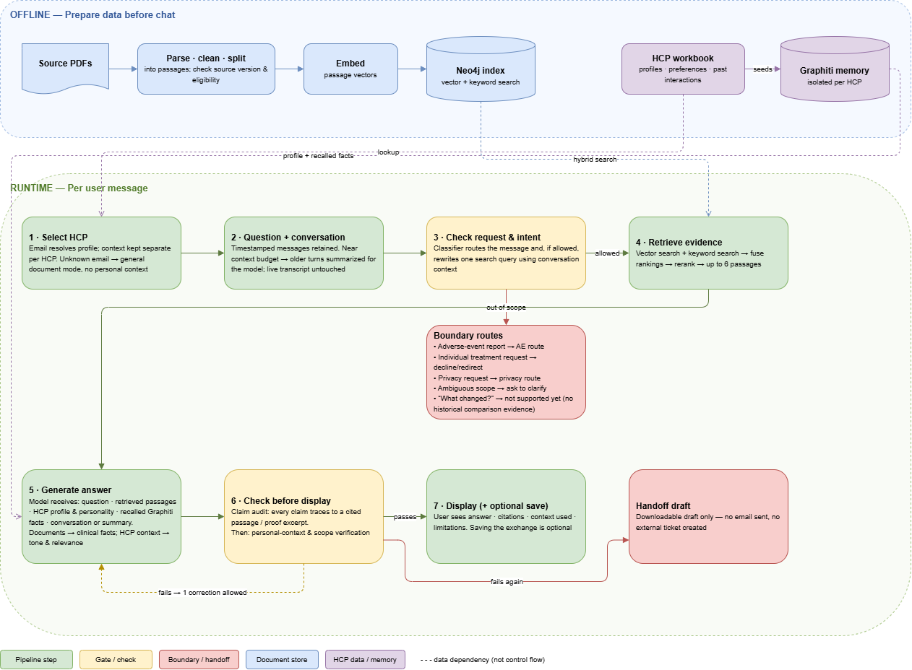

# CAMZYOS Contextual Rep

A Streamlit prototype for CAMZYOS product-information questions from healthcare professionals in
Germany. It combines document retrieval with HCP preferences and conversation context, displays its
sources, and prepares a human follow-up draft when policy or evidence prevents an answer.

The repository includes eight synthetic HCP profiles and eight PDFs. Source eligibility is a
prototype review decision, not sponsor approval. The email selector is a demo identity mechanism;
production authentication and external handoff delivery are not implemented.

[](docs/images/hcp-chat-pipeline.png)

| Start here | Contents |
|---|---|
| [Product walkthrough](docs/product-walkthrough.md) | Chat, Compare, Evaluation, Context and source management |
| [Demo scenarios](docs/hcp-demo-scenarios.md) | HCP emails, questions, persona comparisons and boundary cases |
| [Architecture](docs/project-flow.md) | Preparation, retrieval, memory, verification and code locations |
| [Evaluation metrics](docs/evaluation-report.md) | Recorded benchmark values |
| [Evaluation method](docs/evaluation.md) | Reproduction, datasets, limitations and guardrail findings |
| [Implementation status](docs/status.md) | Verified behavior and unresolved limitations |

For a fresh clone, install Git and Python 3.13 (the version used for the recorded setup). After cloning,
run the setup commands from the repository root. The workbook and PDFs are included; each person supplies
their own model API key and local database password. Virtual environments, databases, document
indexes and `.env` are created locally and are not included in the clone.

Follow this order: **clone → install Python dependencies → configure `.env` → start Neo4j → prepare
documents and HCP memory → start Streamlit**. Opening Streamlit alone does not build the indexes.

```shell
git clone https://github.com/aribakhtar/camzyos-contextual-rep.git
cd camzyos-contextual-rep
```

On Windows PowerShell:

```powershell
py -3.13 -m venv .venv
.\.venv\Scripts\python.exe -m pip install -c requirements.lock -e '.[dev,eval]'
if (-not (Test-Path -LiteralPath .env)) { Copy-Item -LiteralPath .env.example -Destination .env }
```

On macOS/Linux:

```bash
python3.13 -m venv .venv
source .venv/bin/activate
python -m pip install -c requirements.lock -e '.[dev,eval]'
test -f .env || cp .env.example .env
```

Edit the new `.env` locally: set `OPENAI_API_KEY` and choose a `NEO4J_PASSWORD` of at least eight characters.
The committed `.env.example` is a template, not a working credential file.
Keep existing credentials when returning to a configured installation. The bundled input paths and
local database defaults need no changes. Model, embedding, Graphiti and RAGAS calls incur API usage.
Optional NCBI settings are not needed for the core application. Never commit `.env`.

Neo4j is required for document vectors and Graphiti's HCP memory. **Docker is optional**: the included
`compose.yaml` starts only Neo4j, with persistent database storage. It does not run Streamlit or the
Python application, and no Neo4j cloud account is needed. Choose **one** database option:

| Machine / preference | Database option |
|---|---|
| Windows without Docker | Use the portable Windows helper below; it downloads its own Java and Neo4j |
| Windows, macOS or Linux with Docker | Use Docker Compose below with Docker running |

For the Docker option:

```shell
docker compose up -d
docker compose logs --tail 30 neo4j
```

Wait for Neo4j to finish starting before preparing documents. Alternatively, on Windows without Docker:

```powershell
.\.venv\Scripts\python.exe scripts/local_neo4j.py setup
.\.venv\Scripts\python.exe scripts/local_neo4j.py start
```

The portable helper keeps Java and Neo4j under ignored `.runtime/`; `setup` is needed only initially.
Changing the password in `.env` does not change credentials in an already initialized database.
Both options use the same configured localhost connection. Do not start both on the same ports.

With Neo4j running and `.env` configured, the Windows launcher prepares the documents and memory
before starting Streamlit. It stops if a required preparation check fails:

```powershell
powershell -NoProfile -ExecutionPolicy Bypass -File scripts/start.ps1
```

Add `-PrepareOnly` to prepare without launching the UI. On other platforms, use the activated
environment and run the equivalent steps:

```shell
python -m camzyos.cli build
python -m camzyos.cli index-all
python -m camzyos.cli doctor --strict --all-documents
python -m camzyos.cli seed
python -m streamlit run app.py
```

Open <http://127.0.0.1:8501> and select `anna.weber@example-clinic.de`. Try:

> Please answer in English: How should CAMZYOS capsules be taken?

The sidebar should report **Retrieval ready**. Use **Chat** for a conversation, **Compare** for the
same question with three context settings, **Evaluation** for the bundled evaluation cases,
**Sources & updates** for document review, and **Context** to inspect the selected synthetic profile.
Saving new conversations is off by default. The [walkthrough](docs/product-walkthrough.md) explains
these controls; [demo scenarios](docs/hcp-demo-scenarios.md) provides other HCP emails and questions.

Preparation parses and chunks the PDFs, creates Neo4j embeddings, verifies both indexes and seeds
isolated HCP memory. Compatible existing embeddings and unchanged seeds are reused. The clinical
index currently contains 20 eligible passages; the separate inspection index covers all eight PDFs.
Chat requires a complete clinical index and never parses or embeds document files on a question.
New or changed source versions remain staged until review; see [source coverage](docs/all-pdf-testing.md).

For subsequent launches, start the same database and rerun the launcher or preparation steps above;
unchanged work is reused. Stop foreground Streamlit with Ctrl+C, then stop the chosen database:

```shell
docker compose down
```

Or, for portable Windows Neo4j:

```powershell
.\.venv\Scripts\python.exe scripts/local_neo4j.py stop --timeout 60
```

These shutdown commands preserve database storage. Do not delete the Docker volume to stop the app.

To work on the code after setup, create a branch with `git switch -c feature/your-change`. The editable
installation uses your working-tree Python files. Run the checks below before submitting changes;
do not commit generated `data/`, `.runtime/`, `reports/` or credentials. Keep source eligibility,
storage consent and HCP isolation intact. Start with [product scope](docs/context.md) and
[architecture](docs/project-flow.md) when changing behavior.

Run checks from the activated environment, or replace `python` with `.\.venv\Scripts\python.exe`
on Windows:

```shell
python -m pytest -q
python -m ruff check .
python -m camzyos.cli doctor --strict --all-documents
python -m evals.retrieval --ragas
python -m evals.retrieval --ragas --answers
```

The automated pytest suite uses isolated fixtures and does not require a running Neo4j instance or
real API credentials. `doctor` and the live evaluations require the configured services and prepared
indexes. The last two commands make paid model calls and create local reports. Compare shows outputs from
generic, document-only and contextual modes; Evaluation scores bundled source-linked cases.
Scores are diagnostic, not clinical approval. Known false passes, routing failures and evaluator
limitations remain documented in [evaluation](docs/evaluation.md) and [status](docs/status.md).

If startup fails, check these first:

| Symptom | Check |
|---|---|
| API key missing | Create `.env` from the template and enter your own key locally |
| Neo4j unavailable / authentication failed | Start the selected database and use its existing password in `.env` |
| Retrieval not ready | Complete preparation, then run `python -m camzyos.cli doctor --strict --all-documents` with the virtual environment's Python |
| Port already in use | Stop the previous app/database process; use only one Neo4j option |

After changing `.env`, restart Streamlit to load the new configuration. Deleting `.env` does not
remove credentials already loaded by a running process or change an existing database's password.

| Directory | Responsibility |
|---|---|
| `camzyos/` | Policy, document preparation, retrieval, memory and response verification |
| `app.py` | Streamlit interface |
| `assets/` | Original workbook/PDFs, provenance hashes and recorded prototype source review |
| `evals/` | Evaluation cases, runners and report generation |
| `tests/` | Automated implementation checks |
| `scripts/` | Preparation, startup and portable Neo4j lifecycle |
| `docs/` | Product scope, architecture, usage, sources and evaluation |

The workflow is coordinated directly in Python; it does not use LangGraph. Graphiti manages HCP
memory, Neo4j stores vectors and graph data, and SQLite stores source versions and consented chat
records. Conversation storage is opt-in, and handoffs are downloadable drafts, never automatic sends.
Generated data, runtime downloads, credentials and raw reports are excluded from Git. See
[asset provenance](assets/README.md), [source attribution](docs/sources.md) and [product scope](docs/context.md).
