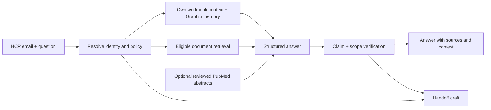

# CAMZYOS Contextual Rep

A Streamlit prototype for personalized CAMZYOS information for HCPs in Germany. It combines the supplied HCP workbook, Graphiti memory, and separately controlled document retrieval. Every generated clinical claim must reference retrieved evidence; unsupported requests produce a handoff draft.

**Current state:** runnable locally, with deterministic tests and live source checks. Add your API key for generation, embeddings, Graphiti extraction and RAGAS scoring. No live answer-quality improvement is claimed yet. See [verification and limitations](docs/status.md).

## Run on this machine

The local `.env`, Python environment and portable Neo4j have already been prepared. The workbook and original PDF folder are referenced by `.env`; they are not uploaded to GitHub.

1. Add `OPENAI_API_KEY` to `.env`. Keep the existing Neo4j password. Model names and retrieval options are in `config.yaml`.
2. From this repository in PowerShell:

```powershell
.venv\Scripts\python.exe scripts/local_neo4j.py start
.venv\Scripts\python.exe -m camzyos.cli doctor
.venv\Scripts\python.exe -m camzyos.cli sync
.venv\Scripts\python.exe -m camzyos.cli seed
.venv\Scripts\python.exe -m streamlit run app.py
```

Open http://127.0.0.1:8501. Use `anna.weber@example-clinic.de` or another supplied HCP email. `sync` embeds active documents; `seed` imports the eight supplied synthetic contexts into isolated Graphiti groups. Both use the configured model API and incur usage. Repeating an unchanged seed skips its existing episode.

Without a key, profile loading, lexical retrieval previews, deterministic handoff rules, source review and update staging work. The app explicitly labels previews as passages, not generated medical answers.

## Fresh installation

Python 3.13 was tested; Python 3.11+ is supported by the project declaration.

```powershell
py -3.13 -m venv .venv
.venv\Scripts\python.exe -m pip install -c requirements.lock -e '.[dev,eval]'
Copy-Item .env.example .env
```

Set `WORKBOOK_PATH`, `PDF_DIR`, `OPENAI_API_KEY` and a non-empty `NEO4J_PASSWORD` in `.env`. Absolute input paths avoid working-directory ambiguity. Provide an existing Neo4j database, or use the optional Windows helper:

```powershell
.venv\Scripts\python.exe scripts/local_neo4j.py setup
.venv\Scripts\python.exe scripts/local_neo4j.py start
.venv\Scripts\python.exe -m camzyos.cli ingest
.venv\Scripts\python.exe -m camzyos.cli fetch --source de_fachinformation
.venv\Scripts\python.exe -m streamlit run app.py
```

The helper downloads a private Java/Neo4j runtime into ignored `.runtime/`; it does not install a Windows service or change global Java. On a fresh installation, sources remain **staged**. Review them in **Sources & updates**, enter an accurate review note, and activate only eligible, usable versions. Prototype eligibility is not sponsor approval.

## What is implemented

| Area | Behavior |
|---|---|
| HCP personalization | Deterministic own-profile lookup, personality, last interactions, experience, language, concerns and already-received content; selected context IDs shown with the answer. |
| Graphiti | Per-HCP temporal memory using `group_ids`; consent-gated new memory; assistant-generated clinical claims are not stored as medical facts. |
| Document RAG | PyMuPDF, repeated-margin cleanup, sentence-preserving soft chunks, page/section anchors, Neo4j vector retrieval plus BM25 rank fusion. |
| Source control | Market, audience, account, dates and active-version filtering; immutable PDF snapshots and source metadata. Placeholders never enter clinical retrieval. |
| Grounding | Structured claim/evidence IDs, deterministic citation checks, separate model verification, refusal when support is insufficient. |
| Handoff | Patient-specific, off-label, comparative, privacy, adverse-event, product-quality and human-request routing; short downloadable draft, never automatically sent. |
| PubMed | Off by default; fixed drug/topic queries contain no HCP data; fetched PMID metadata, abstract-only labeling, correction/retraction checks and a reviewed-PMID allowlist. |
| Updates | SHA-256 plus pipeline fingerprint; changed PDFs are reparsed and staged; activation switches versions transactionally. Updates do not trigger outbound messages. |
| Comparison | Same configured model in generic, document-only and contextual modes; no evaluation memory writes. RAGAS clinical faithfulness plus tests and a human-review rubric. |



Graphiti handles interaction memory. `neo4j-graphrag` handles document vectors; SQLite handles transactional source versions and consented transcripts. This avoids treating graph-extracted medical statements as the source of truth. No separate vector service or free-running agent loop is needed.

## Source updates and evaluation

Use **Sources & updates** to upload a replacement or check the configured publisher URL. Inspect the extraction audit before activation, then sync embeddings. Unchanged source bytes and pipeline settings skip parsing. Withdrawn, expired and superseded versions cannot support new answers; historical answers retain their original citations.

```powershell
.venv\Scripts\python.exe -m pytest -q
.venv\Scripts\python.exe -m ruff check .
.venv\Scripts\python.exe -m evals.run --limit 2 --ragas
```

The last command makes paid model calls and writes ignored `reports/comparison.jsonl`. A complete run covers eight profiles × four questions × three modes. RAGAS scores clinical claims against evidence; personalization is assessed separately. Report failures and abstentions alongside scores. See [evaluation guide](docs/evaluation.md).

The German Fachinformation currently remains staged because its columns, hyphenation and diagrams need further extraction review. The local active corpus uses the checked EMA SmPC prose, with structured pages excluded. Hospital/payer evidence and explicit account affiliations have not been supplied. These are visible content gaps, not invented context.

## Repository map

- [Discussion context](docs/context.md): the complete product brief, choices and scope from our conversation.
- [Detailed requirements](docs/requirements.md): acceptance cases and intended architecture.
- [Reuse research](docs/reuse-research.md): investigated repositories and why Graphiti was chosen.
- [Source ledger](docs/sources.md): every added source and its contribution.
- [PDF review](docs/document-review.md): supplied corpus review.
- [Implementation status](docs/status.md): verified behavior and remaining limits.

Email entry is synthetic-demo identity selection, not authentication. Source administration is a local reviewer view. Keep this prototype on localhost with the synthetic dataset until verified authentication and application roles are implemented. `.env`, raw inputs, databases, transcripts and reports are ignored by Git.
