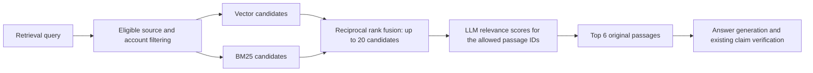

# Retained conversation history, working summaries and document reranking

The full conversation is retained. Summarization changes what is sent to the model, not the original
transcript. Short conversations are sent in full; the previous last-six-message truncation is removed.
This is implemented in [conversation.py](../camzyos/conversation.py), with integration in
[engine.py](../camzyos/engine.py), [store.py](../camzyos/store.py), and [app.py](../app.py).

## Using the application

- **Clear this conversation** explicitly clears the current browser-session conversation and its
  working summary. It does not delete already saved history or Graphiti facts.
- **Forget saved chat memory** explicitly removes the selected HCP's saved chat rows, working
  summary, delivery records and Graphiti group. The bundled workbook remains. A graph outage is
  reported if graph deletion cannot complete.
- **Download full conversation** exports the current complete transcript, with message IDs, UTC
  timestamps and answer metadata. Earlier turns remain available after automatic summarization.
- **Save my new conversations and memory** is off by default. Without it, new conversation data
  stays in Streamlit's browser session and is lost if that server/session ends. With it, new turns
  are saved and restored with their dates; successful answers may also add attributed Graphiti facts.
  Handoffs/errors are now retained in the consented transcript as well.
- Switching HCPs hides the previous conversation and restores the selected HCP's own session history
  when switching back. It does not clear either transcript. Storage choice resets on identity changes.
  Email selection remains synthetic-demo identity selection, not production authentication.

Turning saving on later does not retroactively save earlier unsaved turns. A summary is persisted
only when all messages it covers exist in that HCP's consented transcript. Otherwise the summary
remains session-only. Proactive delivery consent is separate; no outbound sender has been added.
Saved handoff drafts likewise exclude earlier unsaved transcript excerpts, summaries and safety
indicators. The complete draft remains available in the current session for explicit review/download.

## Working-context behavior

Each request counts the instruction, structured-output schema, current question, selected history,
summary and other payload content. Generation includes HCP context and eligible evidence; the
correction request is counted again with its prior answer. The application reserves output capacity
and a safety margin. Local token counts are estimates, with explicit framing headroom.

Current settings in [config.yaml](../config.yaml):

| Setting | Value | Meaning |
|---|---:|---|
| `context_window_tokens` | 32,000 | Application request budget, not a claim about the model's maximum capacity |
| `max_output_tokens` | 2,200 | Reserved answer output allowance |
| `context_safety_margin_tokens` | 1,024 | Additional headroom |
| `conversation_compact_at` | 0.8 | Summarize when estimated input passes 80% of the remaining input budget |
| `conversation_summary_tokens` | 1,200 | Maximum stored summary content size in tokens |
| `conversation_summary_batch_tokens` | 6,000 | Maximum older-message batch size for incremental summarization |
| `conversation_recent_messages` | 6 | Preferred recent verbatim messages after compaction; can reduce to two when needed to fit |

With the default answer allowance, the input budget is 28,776 tokens and compaction triggers above
approximately 23,020 estimated input tokens. Summary generation and reranking have their own output
allowances, which are also reserved by the shared request-budget check.

Older complete messages are summarized in bounded batches with message-ID attribution. Subsequent
requests reuse the summary while its covered prefix is unchanged; new batches are summarized only
as needed. Changing identity, editing an earlier message, or changing the summarizer configuration
invalidates an incompatible cache. Original message content and timestamps are never rewritten.
Notes label their subject (HCP, patient, assistant, conversation or unknown). The summarizer must keep
HCP preferences separate from patient details and retain dated, historical status rather than infer
the present state. These labels make attribution reviewable; they do not guarantee semantic accuracy.

A separate historical safety ledger preserves patient/event/complaint/privacy and prior-route
indicators even if summary prose omits one. These are historical context for interpreting follow-ups,
not a command to escalate unrelated future general questions. Both summaries and history are
untrusted data, not clinical evidence or executable instructions. Retrieved eligible documents still
must support clinical claims. The summary's source IDs are schema-restricted to the supplied messages;
the application also checks membership and the summary-size bound.

If one message, the recent exchange, a fixed evidence payload, or the resulting summary cannot fit,
the app keeps the transcript and asks the user to split the request/start a new conversation. It never
silently clips a message or proceeds with missing history after summarization fails. A summarizer
service/schema failure is recorded as an error without producing a clinical answer. Summaries are
lossy working representations, so the original transcript remains the record for detailed review.

Graphiti continues to provide up to five own-HCP facts; it does not control this context window.
This change does not re-import the existing workbook seed or rewrite Graphiti episode timestamps.

## Document reranking

Clinical retrieval now performs:



`retrieval_candidate_k: 20` is separate from `retrieval_top_k: 6`. The configured `gpt-4.1-mini`
connection scores candidates from 0–3 for relevance; ties retain hybrid rank. This is LLM relevance
reranking, not a local cross-encoder model. It requires no new provider key, database, or model-weight
download. It adds a model call and latency when there is more than one candidate.

The reranker only receives the query and already eligible document passages. It cannot rewrite
passage text, approve a source, introduce foreign IDs, use inspection passages, or bypass account
scope. IDs are constrained in its output schema and checked again for exact coverage/uniqueness.
Eligibility is rechecked after reranking to catch a source withdrawn during the model call.

On a reranker service/schema failure, the app reports a warning and uses the existing hybrid order.
Vector-index readiness remains mandatory; this is not a lexical-only fallback. Scores are relevance
ratings, not clinical confidence probabilities, and no new score threshold authorizes medical claims.
Each returned passage records candidate rank, reranked rank, score, reason and model in its
`retrieval` metadata; evaluation JSON preserves this information.

Set `reranking_enabled: false` for a controlled comparison with the original hybrid retrieval order.
Do not change source eligibility or add synthetic clinical evidence to improve a score.

## Verification and limits

Run the automated checks:

```powershell
.\.venv\Scripts\python.exe -m pytest -q
.\.venv\Scripts\python.exe -m ruff check .
.\.venv\Scripts\python.exe -m camzyos.cli doctor --strict --all-documents
```

For source-pinned live retrieval scoring:

```powershell
.\.venv\Scripts\python.exe -m evals.retrieval --ragas
```

This makes paid model calls. Preserve separate reports for comparisons and inspect warnings as well
as scores. The four bundled cases are disclosed smoke questions, not an independent held-out set.
The original 132-case report is preserved; these features do not by themselves resolve its clinical
generation, negation, temporal-update or pharmacovigilance-routing failures.

On 30 October, 294 tests and 14 subtests passed, with Ruff/dependency checks clean. Live verification
retained all 100 original messages while summarizing 94; the final summary used 150 tokens and was
reused without another summary call. A patient-specific follow-up handed over, while an unrelated
general product question was answered. Paired retrieval smoke questions moved the pinned passage
from ranks 4/2/6/1 to rank 1 in every case. Reports and failed attempts are retained locally in
`reports/conversation-reranking-verification.md`.

Manual summary review remains necessary. An initial run assigned the HCP's English preference to the
patient; subject labels and clearer attribution instructions corrected that in subsequent samples.
The final samples still added small unsupported details (linking an unspecified appointment to the
patient, and expanding a patient's German preference into written follow-up). These are observed
semantic limitations, not a passed faithfulness check. Original messages remain the authoritative
record, and historical summaries cannot support clinical claims.

The structured-output implementation follows the existing Python client pattern and the
[official OpenAI Structured Outputs documentation](https://developers.openai.com/api/docs/guides/structured-outputs).
Valid structure/IDs do not establish factual correctness; the existing eligibility and answer
verification steps remain required.
