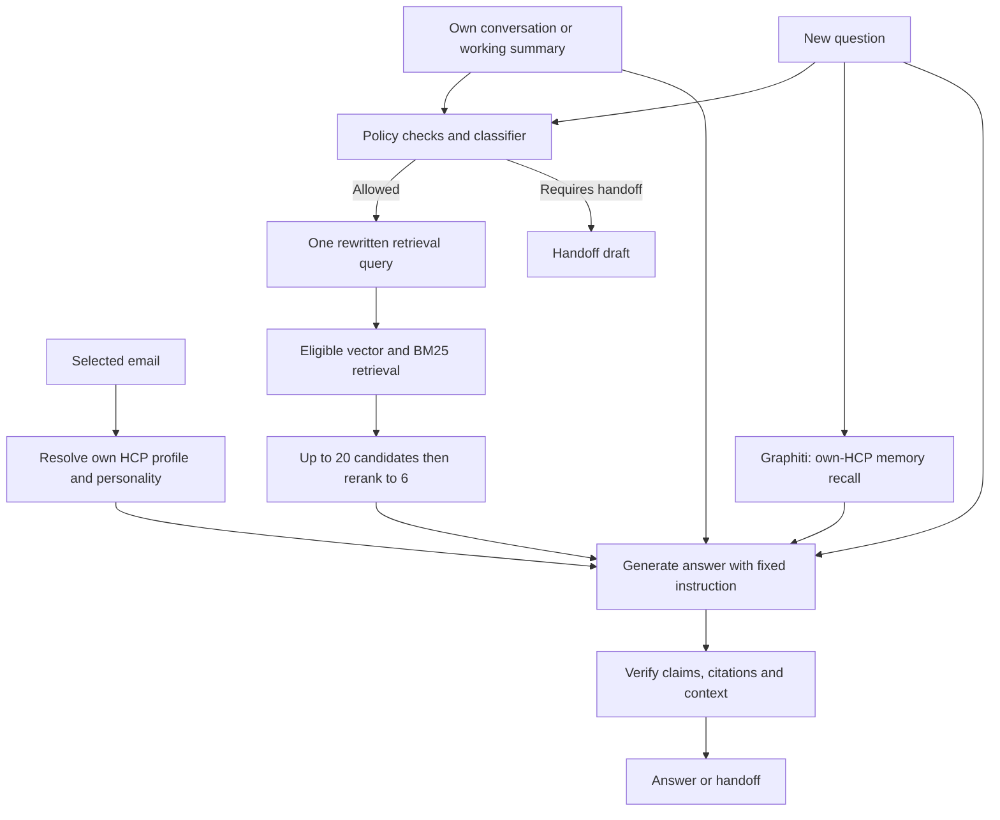
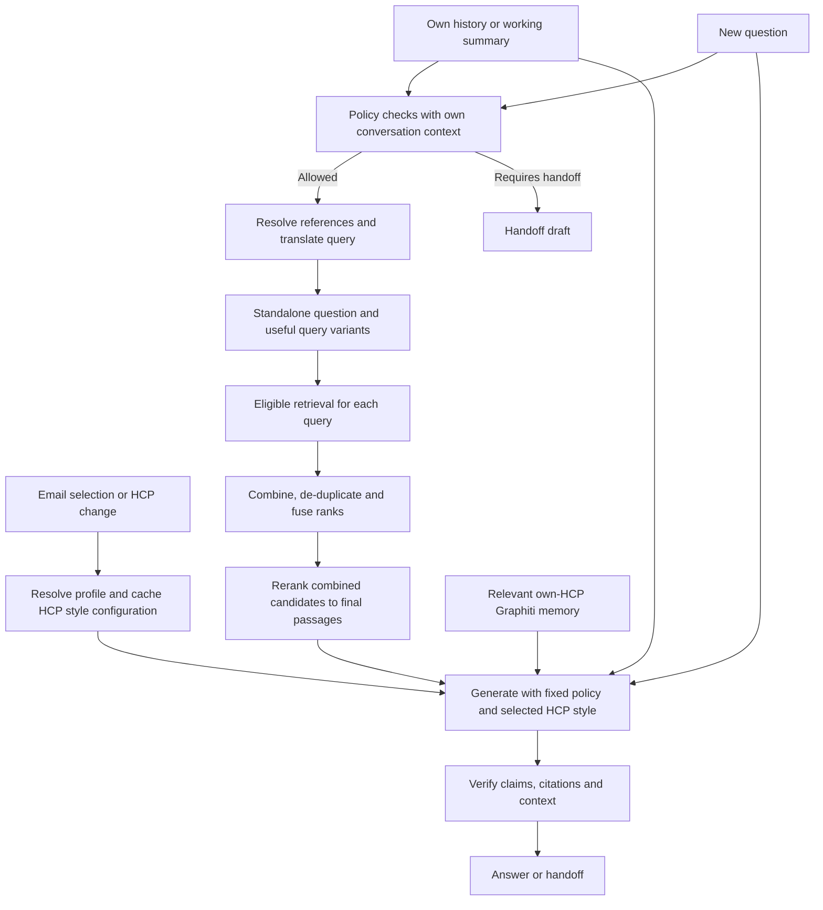

# Current flow compared with the proposed HCP session and query-translation flow

The current implementation already uses HCP context, conversation-aware query rewriting, document
retrieval and reranking. The proposed changes are to prepare/cache HCP response-style configuration
at session selection and generate multiple retrieval queries when useful. They are not yet implemented.

The subsequent [routing and evidence fixes](guardrail-fixes.md) add per-claim proof audits and an
explicit stop for historical-change claims without reviewed comparison evidence. That page also
shows how the proposed planner would separate HCP memory from source-version comparison.

| Stage | Current application | Proposed flow |
|---|---|---|
| Select HCP | Email resolves a workbook HCP; histories are scoped per HCP. | Same identity boundary. Prepare the selected HCP's response-style configuration here. |
| Personality and preferences | Workbook context is rebuilt for each `ask`; the response model receives it as payload data. | Cache the HCP style configuration and refresh on HCP switch or profile/version changes. |
| System instruction | Fixed `GENERATE` policy/instruction; no per-HCP system prompt is installed in the model. | Fixed safety/evidence policy plus a selected-HCP style/context block. The application can cache that block. |
| Conversation | Full transcript retained; working summary plus recent messages when needed. | Same retention and summary behavior. |
| Query translation input | New question plus conversation/summary; personality is not supplied to this classifier. | New question plus conversation/summary, as described. Personality need not change medical retrieval intent. |
| Query translation output | One `retrieval_query` string, which may contain English/German wording. | A standalone rewritten question plus multiple complementary queries where justified. |
| Retrieval | One query into vector + BM25, reciprocal rank fusion, up to 20 eligible candidates, rerank to six. | Retrieve for query variants, combine/de-duplicate eligible results, fuse ranks, then rerank one combined pool to a bounded final context. |
| Graphiti | Recall up to five own-HCP facts using the current question, after document retrieval. | Continue as memory provider; optionally use relevant memory to resolve history references before query translation. |
| Final generation | Fixed instruction + question + HCP context + Graphiti facts + history/summary + six passages. | Fixed policy + cached HCP style block + question + history/summary + relevant memory + selected passages. |
| Verification | Per-claim proof audits plus citation/context checks, bounded correction, and handoff on failure. | Preserve these checks and the existing consent/source/HCP boundaries. |

## Current flow

The Graphiti arrow shows a data dependency; in the current Python function its recall call runs after
document retrieval. The classifier does not currently use recalled Graphiti facts.

## Proposed flow

Graphiti provides memory in either design. It does not currently own the system prompt, query
translation, multi-query retrieval, or the response-generation workflow. The application coordinates
those steps directly in Python; it does not use LangGraph.

## Implementation details that matter

- **Cache construction, not an assumed permanent model instruction.** The current API calls send
  their system instruction and payload on every request. A cached HCP block would still be included
  when the response model is called. Email switching is one invalidation trigger; changed profile
  data or an explicit preference update also needs to refresh it.
- **Keep policy fixed.** HCP personality determines presentation and relevant emphasis. It cannot
  override source eligibility, medical boundaries, confidentiality, or explicit current preferences.
  Keep raw workbook/Graphiti text as labelled context data rather than unrestricted instructions.
- **Resolve language precedence explicitly.** The current generator contains both “follow explicit
  requests, then HCP preference” and “match the question's language”. These conflict for an English
  question from a German-preferring HCP. Caching the existing text alone will not resolve this.
- **Use multiple queries selectively.** Simple questions may need only a standalone rewrite.
  Compound or ambiguous questions can benefit from decomposition, synonyms or bilingual variants.
  More queries add latency and can introduce irrelevant passages; measure the change rather than
  assuming it improves RAG scores.
- **Bound the combined context.** Retrieve candidates per query, then select a final shared passage
  budget. Do not concatenate six passages from every query without de-duplication and reranking.

Code references: [query schema and prompts](../camzyos/engine.py), [conversation budgets](../camzyos/conversation.py),
[hybrid retrieval](../camzyos/retrieval.py), [reranking](../camzyos/reranking.py),
[Graphiti recall](../camzyos/graph.py), [HCP session controls](../app.py).

The full evaluation report for the existing implementation is in local
`reports/full-evaluation-20261030T105623Z/review.html`. It does not evaluate the proposed architecture.
