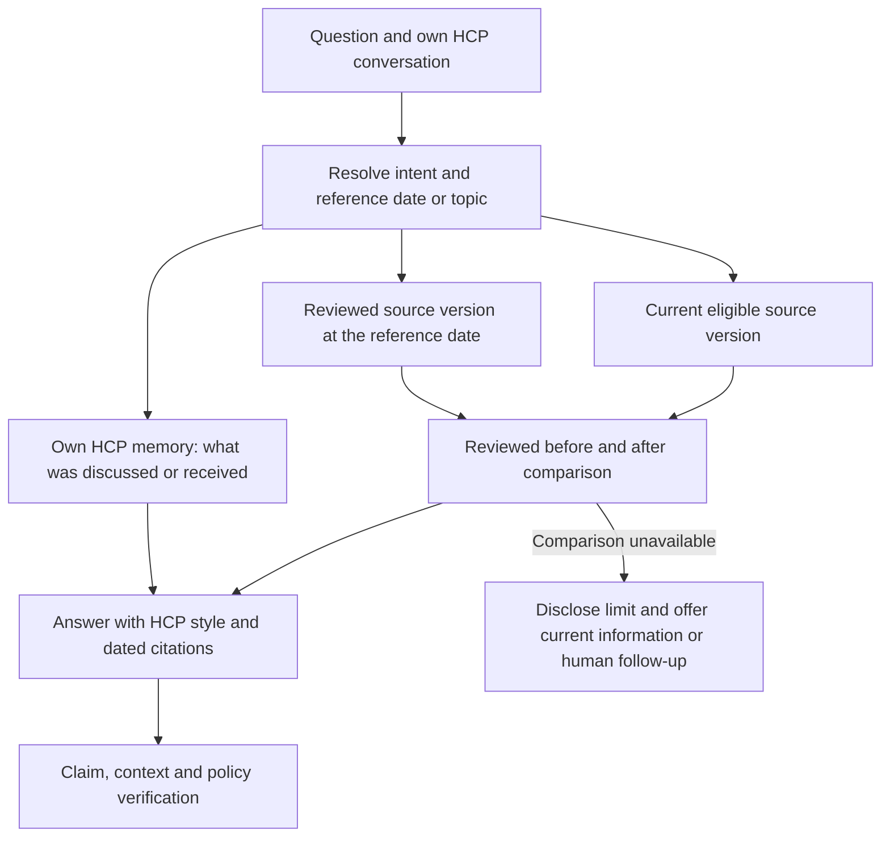

# Evidence and routing regressions, 30 October 2026

The full benchmark exposed a false RAGAS pass: `ray_001` combined different renal and hepatic
instructions, contradicted its cited passage, and still received faithfulness 1.0. The original
`reports/full-evaluation-20261030T105623Z/` results are preserved. A score is an observation from a
fallible evaluator, not permission to display a clinical claim.

## Changes

| Failure | Implemented check | Remaining limitation |
|---|---|---|
| Symptoms reported after treatment routed elsewhere | Reported-event checks precede routine patient/scope routes; classification distinguishes actual reports from hypothetical/denied events. | Rules cover selected English/German phrasing; generalization needs broader reviewed cases. |
| Current label described as an update | Change requests produce an explicit temporal plan and disclose that reviewed before/after evidence is unavailable. Generation/verification also reject unsupported novelty claims. | No historical source comparison workflow is implemented. |
| Wrong off-label rationale | Classifier receives the actual eligible indication excerpt; an off-label decision needs affirmative scope evidence. Unsupported classifications ask for clarification. Negated scope requests and Child-Pugh terminology are tested. | Lexical checks and the classifier remain imperfect. A clarification can still be unnecessary. |
| Combined clinical claim falsely accepted | A separate audit decomposes each claim and examines only its own cited passages. Proof excerpts must exist verbatim, IDs must match, and renal/hepatic support must match the population subsection. | The audit uses the same configured model. Literal quote validity alone does not establish semantic entailment. |

The final answer still requires the existing citation, personal-context and policy verification.
A failed audit permits at most one correction; a second failure withholds the clinical answer.
Audit attempts and reasons are retained in result diagnostics. No clinical instruction is hardcoded
from the failed test, and no staged PDF or workbook placeholder becomes clinical evidence.

PV results contain `draft_not_submitted`, detection time and an explicit next step. They do not create
an external case, assess causality, or meet an operational reporting deadline. An intake connector,
acknowledgement and responsible-person workflow are still needed for actual submission/tracking.
Conversation storage remains opt-in; this change does not silently persist incident reports.

## How the proposed query plan fits

For “What changed since we last spoke?”, separate memory questions from evidence questions:



“New to this HCP” and “changed in the product information” are different questions. Memory identifies
topics previously discussed; it cannot prove a regulatory change or establish everything the HCP knows.
If “new” is ambiguous, clarify whether the user wants changes since a date or information not previously
covered. Prefer focused clinical queries based on those topics over a broad “what is in CAMZYOS” query.

The implemented temporal plan records the selected HCP's workbook interaction date, current eligible
version IDs and the missing comparison step. It does not claim to have retrieved a historical version
or performed a diff. The regular answer path still generates **one** rewritten document query, then
hybrid retrieval and reranking; general multi-query planning remains a proposed improvement. Graphiti
provides own-HCP memory; the Python application coordinates query translation and answer generation.

## Validation

```powershell
.\.venv\Scripts\python.exe -m pytest -q tests/test_grounding_policy.py tests/test_boundaries.py tests/test_answer_schema.py
```

The full suite passed **343 tests and 14 subtests**; Ruff and dependency checks passed. One upstream
Graphiti/Pydantic deprecation warning remains.

Local results are under `reports/guardrail-fixes-20261030T113049Z/`. All **15 targeted case checks** and
**four claim-audit checks** met their specific expectations. The audit rejected the original German
contradiction and an English paraphrase, and accepted both exact-source population controls. All six
previously missed symptom reports reached a PV draft. Three update requests disclosed missing comparison
evidence. The negated off-label case answered; the initiation checklist still handed over because the
auditor returned altered or ellipsis-shortened proof excerpts, without the incorrect off-label rationale.
This verification failure does not establish that the whole question is clinically unanswerable.
General indication, adverse effects and
separate hepatic/renal information controls answered; a genuine off-label request still handed over.

These are known development regressions, not held-out evidence or a repeat of the full 132-case/RAGAS
benchmark. `summary.json`, `responses.jsonl`, `claim-audits.json` and `browser.json` preserve actual outcomes
and execution status. The original faithfulness 1.0 is retained. Code/config/corpus and HCP memory
fingerprints stayed unchanged during the live cases; no conversations were saved.

The first browser attempt exposed a stale Streamlit backend and is retained as
`browser-before-refresh.json` plus its transcript. Session inspection found only isolated test messages;
Streamlit was restarted without discarding user conversations. The refreshed browser passed PV,
temporal-limit and audited indication checks; Chat, Evaluation and Sources & updates loaded without
browser errors. The app is running at `http://127.0.0.1:8501` with the clinical index **20/20 ONLINE**.

Further evaluation needs independently reviewed paraphrases and negative controls, multilingual
symptom reports, compound intents, correct/incorrect scope rationales, and dated version-pair gold.
Measure false refusals, report-route recall and erroneous acceptance separately from average RAGAS.
