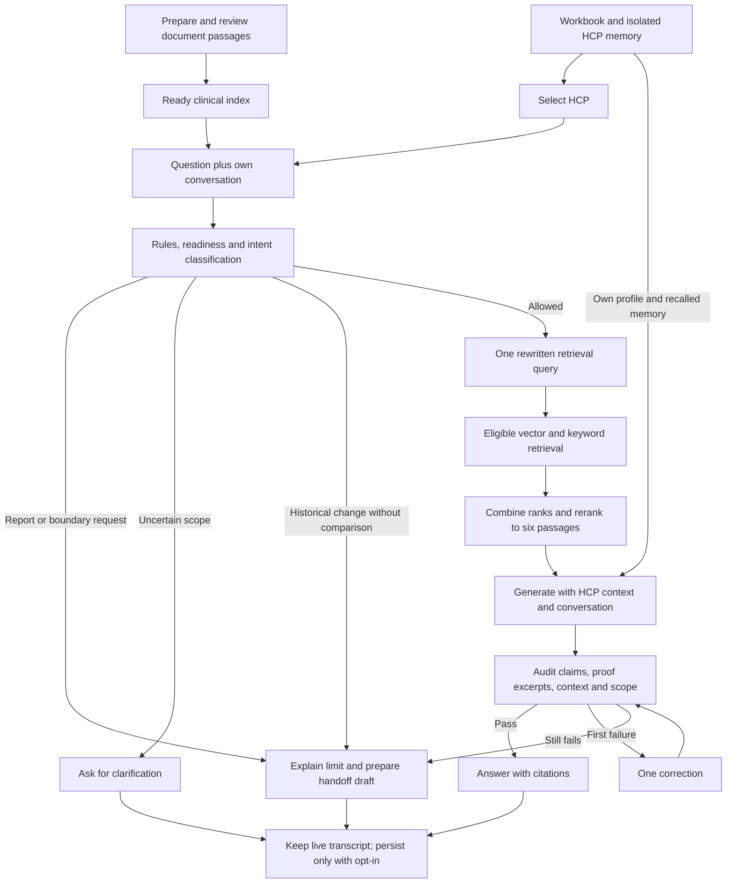

# Product explanation and Streamlit walkthrough

Checked against the running app and code on 30 October 2026.

For exact HCP emails, contrasting personalities, copyable questions and scored comparison commands,
use the [HCP demo scenarios](hcp-demo-scenarios.md).

## A short explanation you can present

“This is a CAMZYOS information assistant for healthcare professionals in Germany. We prepare and
review document evidence before chat starts. When an HCP asks a question, the app checks the request,
retrieves relevant eligible passages, and uses that HCP's preferences and history to shape the answer.
It checks the answer against its citations before displaying it. When evidence or policy does not
support an answer, it explains the limit and can prepare a human follow-up draft.”

This is a research prototype using eight synthetic HCP profiles. Document eligibility is a recorded
prototype review, not sponsor compliance approval. The email field selects a demo identity.

## What happens first, then next

1. **Prepare the documents before questions arrive.** The preparation script parses PDFs, cleans
   repeated margins, splits text into passages, adds source/page/version metadata, creates embeddings
   and checks the Neo4j indexes. Unchanged embeddings are reused. New source versions stay staged
   until review and activation. Only eligible active passages enter clinical retrieval.
2. **Prepare HCP context separately.** The workbook provides profiles, personality/preferences and
   dated interactions. The seed command imports context into separate Graphiti groups for each HCP.
   The workbook's placeholder clinical text is never medical evidence.
3. **Open a ready application and select the HCP.** Streamlit resolves the email to a profile. A known
   HCP gets their own context; an unknown email gets general eligible-content mode. The question box
   requires the model key and a complete clinical index. The key is entered locally in `.env`.
4. **Receive the question and its conversation context.** Each new message gets an ID and timestamp.
   Earlier messages remain in the live transcript. When model input approaches its budget, the app
   summarizes older messages for the model while preserving the original transcript.
5. **Check the request.** Rules and model classification identify reports of adverse events, patient
   advice, off-label requests, comparisons, privacy requests, complaints and explicit human requests.
   A reported event takes the PV route. Ambiguous scope can trigger clarification. Historical-change
   questions disclose that a reviewed before/after comparison is currently unavailable.
6. **Rewrite an allowed question for retrieval.** The classifier uses the new question and its working
   conversation context to produce **one** medical search query. It is instructed to omit identifiers.
   This is conversation-aware rewriting; a general multi-query planner is not implemented.
7. **Retrieve and rank evidence.** Neo4j vector search finds similar passages and BM25 finds keyword
   matches. The app combines their rankings, forms up to 20 eligible candidates and uses an LLM
   reranker to select up to six passages. Source eligibility is enforced before and after retrieval.
   A failed reranker keeps hybrid order with a warning; an unavailable clinical vector index blocks
   answering rather than silently switching to keyword-only evidence.
8. **Assemble the answer context.** The response model receives fixed policy instructions, the current
   question, the selected HCP's workbook context, relevant Graphiti memory, conversation/summary, and
   retrieved evidence. Graphiti recall currently happens after document retrieval. The fixed policy
   is not a personality prompt cached once per HCP; context is supplied with each request.
9. **Generate and check the draft.** Clinical statements need allowed passage IDs. A per-claim audit
   examines the cited evidence, checks exact proof excerpts and separates population-specific claims.
   The existing verifier also checks support, personal context and scope. At most one correction is
   attempted. A continued failure withholds the clinical answer and gives a verification handoff.
10. **Show and optionally retain the result.** Chat displays the answer, citations, used personal
    context, limits or a handoff draft. Saving is off by default. With saving enabled, new turns and
    working summaries can persist locally; supported answer paths can retain user statements and
    source provenance in Graphiti. Generated medical claims do not become clinical memory facts.

HCP memory answers “what matters to this person?” Document evidence answers “what can we support?”
Conversation supplies references such as “that” or “since our last discussion.” These inputs have
different roles: prior assistant statements and HCP preferences cannot establish clinical facts.

The active clinical corpus currently contains **20 eligible EMA SmPC passages**. A separate inspection
index covers **all eight PDFs, 432 passages and 203 pages**. Inspection results include staged/excluded
material and do not feed the chatbot. Neo4j stores both sets of vectors separately and the Graphiti
memory graph; SQLite stores source/version records and consented local conversations. Graphiti does
not manage the prompt window, plan all queries or orchestrate the application. Python does; LangGraph
is not used as the application orchestrator.

## How to orient a new user

Open **http://127.0.0.1:8501**. The sidebar mixes conversation settings and navigation. The main panel
shows whichever view is selected. The five views serve three different jobs:

| Job | View | What the person does there |
|---|---|---|
| Use the assistant | **Chat** | Ask a question, read evidence, continue the conversation or download a draft. |
| Understand personalization | **Context** | Inspect the selected HCP's supplied profile, personality and dated interactions. |
| Compare behavior | **Compare** | Try the same question with generic, documents and contextual modes. |
| Measure a known case | **Evaluation** | Inspect ranked evidence and retrieval/answer metrics for a bundled test case. |
| Maintain or inspect sources | **Sources & updates** | Check indexes, inspect all PDFs and manage staged/active source versions. |

A first-time HCP user mainly needs **Chat**. A presenter can show **Context** to explain personalization.
The other views are testing/reviewer tools; they are not required steps before every question.

## Sidebar controls

| Visible control | Meaning and use |
|---|---|
| **HCP email** | Select a synthetic profile. Start with `anna.weber@example-clinic.de`. Changing identity hides the previous HCP's transcript and restores the new identity's own session; switching back restores the earlier live transcript. This is not verified login. |
| Welcome message | Confirms which HCP is selected; check this before demonstrating personalization. |
| **Save my new conversations and memory** | Off by default. The live conversation still works while off. Enable only when you intend to retain new turns beyond the session; existing saved history is loaded on its first enabled Chat visit for that identity/session. Saving does not grant proactive outreach consent. |
| **PubMed search** | Optional discovery, off by default. Newly found papers are not automatically eligible evidence. The reviewed-PMID allowlist is currently empty. Leave off for the first walkthrough. |
| **Clear this conversation** | Clears the selected live conversation and its working summary. It leaves saved history and Graphiti memory intact. |
| **Forget saved chat memory** | Deletes selected-HCP saved conversations and attempts to clear that HCP's Graphiti group. It also clears the live conversation. The supplied workbook profile/history stays available. A later explicit seed can reimport workbook memory. |
| **View** | Switch between the five panels. |
| **Retrieval ready: 20/20 passages indexed** | Confirms the current eligible clinical corpus is indexed. The count can change after reviewed source updates; “ready” and completeness are what matter. |

“Clear” and “Forget” have different effects. During a demonstration, clearing your isolated test
conversation is usually sufficient. With saving off, ending the session or restarting the server can
lose the live transcript; use **Download full conversation** when you need a copy.

## Chat: the normal product experience

Use the **Ask about CAMZYOS** box at the bottom. A simple first question is:

> Please answer in English: What is CAMZYOS approved for in Germany?

The explicit language request makes the demonstration clearer. Stored language preference and question
language currently have conflicting prompt instructions; do not promise consistent automatic language
selection. Follow-up questions use the same selected HCP's conversation context.

After a response:

| UI element | What to explain |
|---|---|
| Answer with `[1]`, `[2]` references | The numbers map to cited passages in **Sources used**. |
| **Sources used** | Open to see title, section, PDF pages, version, exact passage and publisher link where available. These are the cited passages, not necessarily every retrieved candidate. |
| **Personal context used** | Shows the HCP fields/memory facts the response declared it used. An empty object means no personal context was declared; it is not itself an error. |
| Summary caption | Appears when earlier messages were summarized for model input. The original live transcript remains available. |
| Warnings / limitations | Report unavailable components or evidence limits. They are part of the result. |
| **Relevant evidence-gap review flags** | May appear for workbook flags; these are not proof that medical research is absent. |
| **Handoff summary — review before sharing** | Shows destination, reason and a compact conversation/context draft. PV drafts explicitly say they were not submitted. |
| **Download summary (does not send)** | Exports a JSON draft. It does not open a ticket, email a representative or submit a PV case. |
| **Download full conversation** | Exports the selected conversation with timestamps and result details as JSON. |

Claim-audit diagnostics and the temporal plan are included in result/transcript JSON and review reports;
Chat does not currently provide a separate polished panel for every diagnostic field.

## Context: explain what the assistant knows about this HCP

The main panel displays **Loaded HCP context** as expandable JSON. Inspect `profile`, `personality`
and `interactions`. Profile fields include preferred language, experience, concerns and materials
previously received. Interaction records are ordered by date; the context loader includes up to eight
recent workbook interactions per HCP.

This is a read-only workbook-context view. It is not an editor, a complete Graphiti graph viewer or a
listing of every saved chat. **Personal context used** under an answer is the narrower view of what
that particular response declared it used.

## Compare: demonstrate the contribution of context

Enter an **Evaluation question** and press **Run comparison**. Three columns use the same configured
model and current corpus where applicable:

| Column | Inputs beyond the question | Interpretation |
|---|---|---|
| **Generic** | No retrieved documents or HCP personalization | Unverified model baseline, for comparison only. |
| **Documents** | Retrieved eligible evidence | Shows document-grounded behavior without personal response context. |
| **Contextual** | Eligible evidence plus selected HCP workbook/Graphiti context | Shows how the same supported information is presented with personalization. |

These are fresh requests, not continuations of the live Chat transcript. Runs do not save memory and
do not perform PubMed search. The view shows outputs, not a scored ranking or a guaranteed improvement.
Safety routes can still produce handoffs in any column. Model variation means a single comparison
cannot isolate the effect of personalization reliably.

## Evaluation: test one known case

1. Choose a **Test case**. The current menu contains four source-pinned questions: indication,
   ingredient, administration and storage.
2. Open **Reference and expected source** to see what the test is checking.
3. Choose **Retrieval only** first to examine whether the expected evidence is found and ranked well.
4. Keep **Score with RAGAS** enabled when you want model-judged metrics; these add paid API calls.
5. Press **Run evaluation**. Inspect the actual search query, metric table, errors and ranked passages.
6. Choose **Contextual answer** to run generation and verification as well; this adds answer
   faithfulness when an answer is produced. It uses the selected HCP but not the live Chat transcript.
7. Use **Download evaluation JSON** to preserve the result.

| Metric family | Question it helps answer |
|---|---|
| Reference hit/recall and reciprocal rank | Did the annotated expected passage appear, and how high? |
| RAGAS context precision/recall | Was retrieved context relevant and did it cover the reference? |
| RAGAS faithfulness | Did the judge consider the generated clinical claims supported by retrieved text? |

Scores are fallible; a prior contradiction received faithfulness 1.0. Read the answer and evidence,
record handoffs/errors, and do not treat a high mean as clinical approval. This UI runs one bundled
case at a time. The 132-case HCP JSON, batch repetitions and contextualization evaluation use CLI
runners and report files; there is no custom-case upload or full-suite button on this page.

## Sources & updates: document operations and inspection

For a walkthrough, start with the two readiness indicators:

- **Clinical readiness** concerns the eligible passages the chatbot can use.
- **All-PDF index ready** concerns the broader inspection corpus for all eight PDFs.

Use **PDF to inspect**, **Search PDF text for testing**, and **Search all-PDF testing index** to inspect
extracted passages across files. The result includes the PDF/page and layout-review flag. It is an
inspection search, not a clinical chatbot answer. **Download inspection results** exports those findings.

The remaining controls change prepared source state and belong to the reviewer/setup workflow:

| Control | Action |
|---|---|
| **Build eligible clinical document index** | Run the bundled clinical preparation/indexing workflow. |
| **Build all-PDF testing index** | Prepare or refresh the separate broad inspection corpus. |
| **Source** / **Version** | Select a source and inspect versions, hashes, creation dates and extraction audits. |
| **Stage a replacement PDF** | Uploading automatically starts parsing, chunking and indexing; the new version stays staged. |
| **Process / index source** | Process or retry the selected source. |
| **Check publisher for an updated PDF** | Fetch/process available publisher content on demand. It does not prove what changed clinically. |
| **Review note** and review checkbox, then **Activate reviewed version** | Record the review and activate only after eligibility/index checks. |
| **Withdraw this version** | Exclude that version from new answers. |
| **Sync active document embeddings to Neo4j** | Repair/synchronize the active clinical index. |

Simply showing the page does not require pressing any build/activate/withdraw controls. Source-version
storage is implemented, but a reviewed historical semantic comparison and automatic HCP notifications
are not. The app cannot substantiate “new since last time” from a current PDF alone.

## A five-minute demonstration order

1. Open **Chat**, confirm the HCP name and readiness; leave saving and PubMed off.
2. Visit **Context** briefly to show preferences and one dated interaction.
3. Return to **Chat**. Ask the approved-indication question above, then open **Sources used** and
   **Personal context used**. Record a handoff honestly if verification withholds an answer.
4. Ask **“What has changed since we last spoke?”** to show the historical-evidence limit. It should
   not invent a regulatory change from the current label.
5. Ask **“Please contact an MSL.”** Open the draft and explain that downloading does not send it.
6. Show **Evaluation** as the measurement tool and **Sources & updates** as the source-management tool.
   Use **Compare** in a longer technical demonstration; it makes three separate generation requests.

For a short HCP introduction, stop after Chat and its evidence/context panels. For an engineering
audience, continue through Compare, Evaluation and source operations.

See [the technical flow and techniques](project-flow.md), [test commands](testing-workflow.md),
[the implemented guardrail changes](guardrail-fixes.md) and [current versus proposed architecture](current-vs-proposed-flow.md).
