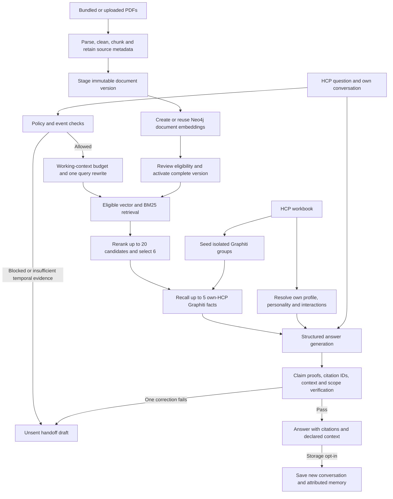

# Architecture and data flow

The application uses a bounded Python workflow, Streamlit, Graphiti, Neo4j and SQLite. LangGraph is
not the orchestrator. HCP context and clinical evidence are stored and checked separately.

Document preparation runs before chat. PyMuPDF extracts text; cleanup removes repeated marginal
headers/footers rather than discarding every heading. Sentence-preserving chunks target 1,600
characters with one-sentence overlap and retain section, page and version references. Structured
pages requiring review are excluded from clinical text retrieval. The separate inspection pipeline
retains every page for testing, with layout flags and no clinical-evidence authorization.

Hashes of source bytes and pipeline settings identify versions. Embeddings use the configured
`text-embedding-3-small` model and 1,536 dimensions. Existing compatible text/model/dimension matches
are reused. Uploaded replacements are indexed while staged; activation requires review and index
readiness. The previous still-valid version remains available if preparation fails. The source
registry enforces market, audience, account scope, dates and active-version eligibility.

At question time, early rules check privacy, adverse-event reports and other handoff boundaries.
The classifier receives the current question and own conversation/working summary, then produces
one retrieval query. It does not receive HCP personality or recalled Graphiti facts. The query is
embedded and used alongside BM25; reciprocal rank fusion combines candidates, followed by LLM
relevance reranking. Failed reranking reports a warning and keeps hybrid order. Missing/unavailable
vector retrieval blocks clinical answers; there is no lexical-only replacement for a missing index.

Generation receives the question, own-HCP profile/personality, relevant workbook interactions,
Graphiti recall, conversation context and eligible passages. Safety instructions are fixed and sent
on each request; no persistent per-HCP system prompt or multi-query expansion is implemented.
The structured response separates clinical claims, evidence IDs and personal-context keys.

Each claim is audited against its own cited passages. The auditor selects excerpt IDs and the
application copies the original source text, preventing paraphrased proof quotations. Contradictions,
missing support and wrong-population evidence still fail the audit. Citation membership, personal
facts and scope are checked separately; an answer without personal assertions needs no profile recap.
Nonempty introductions also receive a focused personal-fact audit without clinical passages, so
missing profile facts cannot be accepted merely because the clinical answer is supported.
Verification reasons are retained for each attempt. One correction is allowed before a validation
handoff. These model-based checks remain fallible; passing them is not independent clinical review.
Historical-change claims require a reviewed version comparison, which the prototype does not yet
provide. Current label text alone cannot establish what changed since a meeting.

Conversation handling preserves original messages and timestamps. The configured working budget is
32,000 tokens, with compaction triggered at 80%, a 1,200-token summary target and normally six recent
messages. Fewer recent messages may be retained in model input if needed; the original transcript is
not truncated. Summaries are attributed, untrusted historical context and may lose detail. A separate
safety ledger preserves relevant indicators. Graphiti does not manage this context window.

Storage is opt-in and scoped to the selected HCP. Graphiti retains attributed user statements and
source provenance, not generated medical claims as established facts. The supplied workbook remains
available after forgetting saved chat memory. PubMed is optional, uses fixed non-identifying topic
queries and contributes only reviewed, unflagged abstracts; the allowlist is currently empty.

| Component | Code |
|---|---|
| UI, HCP switching, consent controls | [app.py](../app.py) |
| HCP resolution and workbook context | [profiles.py](../camzyos/profiles.py) |
| Policy checks and orchestration | [policy.py](../camzyos/policy.py), [engine.py](../camzyos/engine.py) |
| Parsing and clinical chunks | [documents.py](../camzyos/documents.py) |
| Preparation and source activation | [ingest.py](../camzyos/ingest.py), [store.py](../camzyos/store.py) |
| Neo4j vectors and Graphiti memory | [graph.py](../camzyos/graph.py) |
| Hybrid retrieval and reranking | [retrieval.py](../camzyos/retrieval.py), [reranking.py](../camzyos/reranking.py) |
| Conversation budgets and summaries | [conversation.py](../camzyos/conversation.py), [llm.py](../camzyos/llm.py) |
| Per-claim evidence audit | [grounding.py](../camzyos/grounding.py) |
| All-PDF inspection | [inspection.py](../camzyos/inspection.py) |
| Reviewed literature discovery | [pubmed.py](../camzyos/pubmed.py) |

Configuration is in [config.yaml](../config.yaml), source policy in [sources.yaml](../sources.yaml),
and credentials in an ignored local `.env`. See [evaluation](evaluation.md) for measured results and
[status](status.md) for limitations rather than treating proposed improvements as implemented features.
