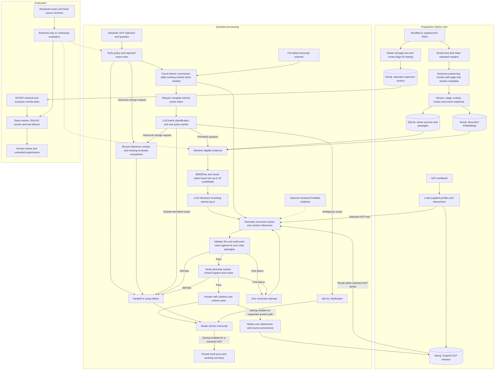
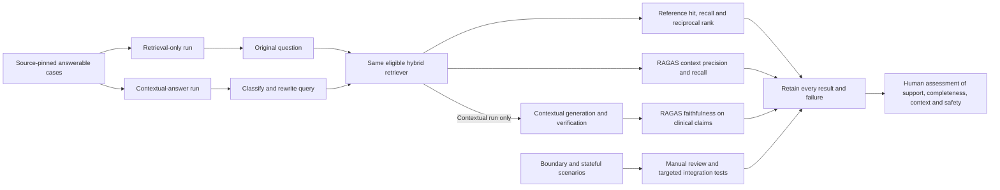

# Project flow, current techniques, and evaluation improvements

Inspected on 30 October 2026. This describes the implemented contextual flow and separately labels proposed experiments. The project uses an explicit Python workflow in `camzyos/engine.py`; it does not use LangGraph as its orchestrator.

For a presentation-ready explanation and a tour of every Streamlit control, start with the
[product and UI walkthrough](product-walkthrough.md). This technical map includes the subsequent
reported-event, temporal-evidence and per-claim audit changes.

The preparation pipeline now also builds a separate [all-PDF inspection index](all-pdf-testing.md): 432 chunks from all eight PDFs / 203 pages. This index is available for extraction/retrieval testing and never feeds clinical answer generation.

## Overall flow

The diagram groups some steps for readability. SQLite holds the source registry, immutable passage metadata, and consented local chat records. Neo4j holds document vectors and a separate Graphiti memory graph. Workbook profile/history and graph memory personalize answers; neither supplies clinical evidence. PubMed is off by default and currently has an empty reviewed-PMID allowlist.

Sources are filtered by active version, DE/EU market, HCP audience, validity dates, permitted pages, and account scope. Vector retrieval is restricted to permitted versions and its returned IDs are intersected with eligible passages again. Missing or failed vector retrieval blocks a clinical answer; BM25 is not a fallback around readiness checks.

For replacements, the pipeline stages and indexes before reviewed activation. Bundled bootstrap can restore only the exact recorded demo review before syncing vectors; startup/readiness gates keep that intermediate state out of chat. A restored demo review is not a new sponsor approval.

An insufficient generated answer also produces a handoff. API failures return an error. The correction loop allows two generation attempts in total. Handoff summaries remain drafts; the app does not send them externally.

Reported symptom-after-treatment cases now take the Pharmacovigilance draft route before ordinary
patient/scope routes. Historical-change requests stop when no reviewed before/after evidence exists;
the current label plus a previous conversation cannot establish a change. These checks do not add
a general multi-query planner. The classifier still emits one search query; Graphiti recall runs
after clinical document retrieval and is not supplied to that classifier.

## Techniques actually implemented

| Component | Current technique and configuration | Code |
|---|---|---|
| Extraction | PyMuPDF text extraction and dehyphenation; repeated-margin/page-number removal with an audit. Structured/diagram pages requiring review are excluded. | [documents.py](../camzyos/documents.py) |
| Chunking | pySBD sentence segmentation; approximately 1,600 characters, one-sentence overlap. Long sentences stay intact; page ranges and nearest section labels are retained. Section labels do not enforce section boundaries. | [documents.py](../camzyos/documents.py) |
| Versioning | PDF SHA-256 plus source/extraction configuration fingerprint; immutable PDF snapshots and passage IDs. Changed versions stay staged until eligible reviewed activation. | [ingest.py](../camzyos/ingest.py), [store.py](../camzyos/store.py) |
| Embeddings | `text-embedding-3-small`, 1,536 dimensions, configured locally. Unchanged compatible document embeddings are reused; the retrieval query is embedded at question time. | [graph.py](../camzyos/graph.py), [config.yaml](../config.yaml) |
| Vector retrieval | Neo4j `camzyos_embeddings`, cosine similarity; version/model filters and eligible-ID validation. Up to 20 vector candidates when reranking is enabled. | [graph.py](../camzyos/graph.py) |
| Keyword retrieval | In-process BM25Plus over eligible chunks, case-folded word tokenization, up to twice the candidate-pool size with query-token overlap. No dedicated language-specific stemming. | [retrieval.py](../camzyos/retrieval.py) |
| Hybrid fusion and reranking | Reciprocal rank fusion `1 / (60 + zero_based_rank)`, then LLM relevance scoring of up to 20 eligible candidates and selection of six original passages. Failures report a warning and retain hybrid order. | [retrieval.py](../camzyos/retrieval.py), [reranking.py](../camzyos/reranking.py) |
| Conversation context | Full dated transcripts retained; bounded incremental working summaries when the token budget approaches its limit, with separate historical safety indicators and consent-gated summary storage. | [conversation.py](../camzyos/conversation.py) |
| Query handling | Early reported-event/policy rules, then model intent classification and one rewritten search query using conversation/summary. Unsubstantiated off-label classification clarifies; historical-change questions require comparison evidence. | [engine.py](../camzyos/engine.py), [policy.py](../camzyos/policy.py) |
| Personalization | Direct workbook context plus up to five Graphiti facts within the selected HCP group, checked again on return. The Graphiti client configures a reranker component; this is separate from clinical document retrieval. | [profiles.py](../camzyos/profiles.py), [graph.py](../camzyos/graph.py) |
| Generation | Configured `gpt-4.1-mini`; structured Pydantic output, request-scoped evidence/context ID enums, separate clinical claims and personal introduction. | [engine.py](../camzyos/engine.py) |
| Verification | ID checks, per-claim atomic evidence audits with validated proof excerpts and population checks, then clinical/context/scope verification. One correction attempt in total; otherwise handoff. All model checks remain fallible. | [grounding.py](../camzyos/grounding.py), [engine.py](../camzyos/engine.py) |
| Persistence | Opt-in local conversation storage and Graphiti retention of user statements/provenance. Generated clinical claims are not written to Graphiti as medical facts. | [engine.py](../camzyos/engine.py), [store.py](../camzyos/store.py) |
| Evaluation | Source-pinned retrieval/RAGAS cases; separate supplied-HCP single/multi-turn runner, routing/context checks and targeted contradiction controls. Outputs/errors and denominators are preserved; subjective context scores failed calibration and are not trusted acceptance metrics. | [evaluation.py](../camzyos/evaluation.py), [retrieval runner](../evals/retrieval.py), [HCP runner](../evals/hcp.py), [context checks](../evals/context_checks.py) |

The prepared baseline contains 20 eligible EMA prose passages. German structured material and excluded algorithms are coverage limitations that better ranking alone cannot fix. HCP selection by email is a prototype selector, not production authentication. Clinical document retrieval currently searches passages; it does not perform graph traversal over a clinical knowledge graph.

## How evaluations connect to the pipeline

The generation branch belongs to the contextual-answer run; retrieval-only runs stop after retrieval scoring. The two runs currently differ in query construction, so score changes are not attributable solely to the answer model. Generation, verification, Graphiti model configuration, and the RAGAS judge currently share `cfg['model']`. Separate calls do not make their errors independent.

RAGAS faithfulness evaluates generated claims against retrieved context, while context precision measures relevance ranking. Neither establishes correct source eligibility or clinical completeness: [faithfulness](https://docs.ragas.io/en/stable/concepts/metrics/available_metrics/faithfulness/), [context precision](https://docs.ragas.io/en/stable/concepts/metrics/available_metrics/context_precision/).

Current evaluation limits:

- The four bundled questions are development smoke cases, not an independent benchmark.
- The reference excerpt must appear wholly inside at least one annotated eligible passage after whitespace normalization. Multi-passage synthesized gold answers need a deliberate evaluator extension.
- `evals.retrieval` supports answerable single-turn cases and a run-wide HCP email. It disables saving and PubMed. The separate `evals.hcp` runner supports the supplied eight-HCP behavioral format and its explicit multi-turn scenarios; a general stateful test DSL is not implemented.
- RAGAS faithfulness scores clinical claim text, not the complete personal introduction. Personalization, exposed identifiers, language, and context correctness need their own checks.
- Results retain retrieved evidence and per-claim audit attempts. The HCP runner additionally captures classifier/generation/verifier calls, including rejected drafts. Ordinary Chat JSON is not a full model-call trace; neither report supplies every component ranking/timing.
- An execution marked successful is not a quality threshold pass. Report handoffs, errors, missing scores, and numbers of scored answers separately.

The completed full benchmark found a contradiction despite RAGAS faithfulness 1.0. The subsequent
claim audit rejects that saved contradiction in targeted tests; it uses the same model and is not an
independent clinical guarantee. [Guardrail fixes and remaining failures](guardrail-fixes.md) distinguish
the full benchmark from the later 15-case/four-audit regression checks.

## Improvement experiments, in order

These are experiments to evaluate; the candidate-pool/reranking implementation in row 5 is now
available. Keep source eligibility, HCP isolation, consent, and clinical verification in every candidate.

| Priority | Proposed change | Why this experiment fits the observed problem | Measure |
|---|---|---|---|
| 1 | Independently review and broaden cases; split by question/attack family before tuning. Extend the supplied HCP runner with deliberate stateful cases. | Four smoke cases and AI-authored behavioral expectations cannot establish generalization; answer-only scores miss boundary failures. | Per-family answer coverage, unsafe answers, unnecessary handoffs, privacy/consent failures, missing-data counts. |
| 2 | Trace routing decisions, original/rewritten queries, BM25/vector/fused ranks, verification attempts, and stage latency. | Distinguish incorrect routing, lost evidence, poor ranking, unsupported generation, and judge disagreement. Preserve failed attempts as diagnostic data, never as approved evidence. | Reproducible failure attribution; latency and available usage data. |
| 3 | Broaden evaluation of the implemented negation/PV/scope fixes and clarify language precedence. | Targeted routing regressions pass, but coverage is limited and current language instructions still conflict. These failures occur independently of embedding quality. | Paired permitted/prohibited cases, route correctness, unnecessary refusal rate, explicit-language compliance. |
| 4 | Compare original query, rewritten query, and fused retrieval from both. First hold the eligible corpus and final context budget fixed. | The current contextual query rewrite can change ranking. | Reference recall/rank and precision by query language and family; downstream answer outcomes. |
| 5 | Compare the implemented 20-candidate LLM reranker / final six passages with hybrid retrieval alone. | Fusion combines ranks but does not directly compare each passage to the question. Four known smoke cases improved reference rank; held-out and downstream answer checks remain necessary. | Recall before reranking, reciprocal rank after reranking, context precision, answer support, latency. |
| 6 | Compare current soft chunks with section-bounded chunks; then consider child retrieval with constrained parent/neighbor expansion. | Current chunks can cross section boundaries or omit nearby qualifications. | Evidence completeness, ranking, citation fidelity, token cost, and clinical review. Re-review changed source versions and migrate reference annotations; do not reuse stale IDs. |
| 7 | Make the judge separately configurable and calibrate against independent human labels; assess the entire response as well as clinical claims. | Generator, verifier, and judge currently use the same configured model, and clinical-only faithfulness misses personal-context defects. | Human/judge agreement, false passes/fails, language/context accuracy, completeness and appropriate abstention. A different judge is still not guaranteed independent or correct. |
| 8 | Review structured/German document extraction where the required information is actually missing. | No ranking algorithm can retrieve excluded or unapproved material as eligible evidence. | Page-level extraction fidelity, eligibility review, expanded case coverage, and regressions after activation. |

A document reranker now adds a relevance-scoring stage after candidate retrieval; see [the implementation and limits](conversation-and-reranking.md). The broader retrieve-then-rerank architecture is also described in the [Sentence Transformers documentation](https://www.sbert.net/examples/sentence_transformer/applications/retrieve_rerank/README.html). This project currently uses the configured LLM, not a Sentence Transformers cross-encoder. Broader clinical-quality improvements still require measurement.

Compare one change at a time on development data, choose on validation, and evaluate the frozen candidate on held-out families. Include the existing hybrid baseline and, in isolated retrieval experiments, lexical-only and vector-only comparisons to establish each component's contribution. These are offline experiments, not permission to enable a BM25-only clinical fallback. Compare document-only and contextual answers on the same model, sources, and questions to isolate personalization effects. For fixed-evidence diagnosis, keep the exact retrieved passages constant while evaluating generation changes; that requires a diagnostic harness rather than the current CLI.

The earlier indication run retrieved its reference at rank four and a contextual run scored faithfulness approximately 0.67. Those observations justify examining ranking and claim support; they do not prove that reranking, a larger model, or a particular chunk size will solve the problem. The separately observed unnecessary routing handoffs should be addressed as routing failures.

See [the testing workflow](testing-workflow.md) for runnable commands and [the adversarial authoring guide](adversarial-test-data.md) for boundary families and proposed review records.
