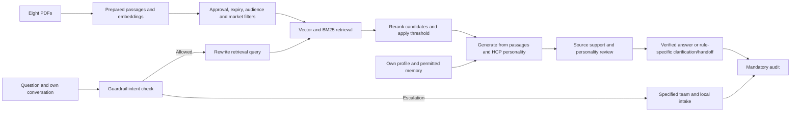

# PDF retrieval and HCP response generation

The prepared index contains all eight PDFs: 432 passages across 203 pages. Normal Chat and grounded
Compare use `retrieval_scope: all_documents`. This selects the physical index; the user's
[16 guardrails](guardrails.md) still govern which passages can answer an HCP question. The current
approval, page, audience and DE/EU market metadata leave 84 passages from two sources eligible.
Other PDFs remain available in the reviewer inspection tools. Indexing is not source approval.

Preparation extracts and embeds documents before chat. Questions embed only their search query.
The retriever combines semantic and keyword rankings, reranks up to 20 candidates and selects up
to six above the configured relevance threshold. Explicitly multipart questions can use up to
three focused queries, with round-robin selection so each requested topic retains evidence. Every citation retains document, market, type,
page and version. Source eligibility and unchanged text are rechecked after reranking and before
release. Unavailable indexes are reported explicitly. Relevance-scoring failure invokes GR_15.

`inspection.py` retains the existing Neo4j index and IDs, so compatible embeddings are reused.
`library.py` applies source/page eligibility to those passages. The old `clinical_evidence: false`
flag records the physical extraction origin, not permission to ignore the current approval gate.
The separate `clinical` mode and 20-passage index remain for source-pinned historical benchmarks;
those scores do not evaluate this updated chat pipeline.

The model receives relevant passages, the question, own conversation and `RESPONSE_STYLE`, which
contains the selected HCP's personality, communication style, language, experience and concerns.
There are no word or claim-count limits. A brief preference calls for focus; a structured preference
calls for clear organization; a risk-first preference affects relevant ordering. Explicit user
requests for language, format or detail override defaults. Otherwise the recorded language applies.
Each claim keeps its own citations. The renderer adds layout without cutting verified text.

Per-claim audits check the exact cited evidence; a separate review checks factual context, scope
and personality adherence. A separate review also checks that every requested topic is addressed.
One correction can address concrete feedback. Only unchanged, proven claims may enter a final
review when an unsupported extra claim remains; incomplete answers are not released as complete.
Continued lack of evidence
or confidence uses GR_11 or GR_15. A narrow question can reasonably produce similar answers for
several HCPs: irrelevant history and risks are not inserted just to manufacture differences.

The workbook supplies fixed profiles directly. Graphiti is optional memory, scoped by HCP group;
it is not necessary for storing eight fixed personalities. `Episodic` nodes represent imported
memory episodes; `Entity` nodes represent extracted concepts. `MENTIONS` links episodes and entities;
`RELATES_TO` carries attributed facts. PDF passage nodes are separate. HCPs need not connect to each
other. Confidential insights are excluded from this signal layer.

Run `python -m pytest -q` and `python -m ruff check .` for offline checks. `python -m evals.demo`
runs live definition and use/safety questions across all eight HCPs, a detailed override, and
escalation cases. It saves complete outputs and validation traces under ignored `reports/`.
`python -m evals.corpus` checks each PDF's inspection retrieval plus eligibility in normal chat.
Both live commands incur model API usage. See [verification](verification-2026-11-06.md) for results.
