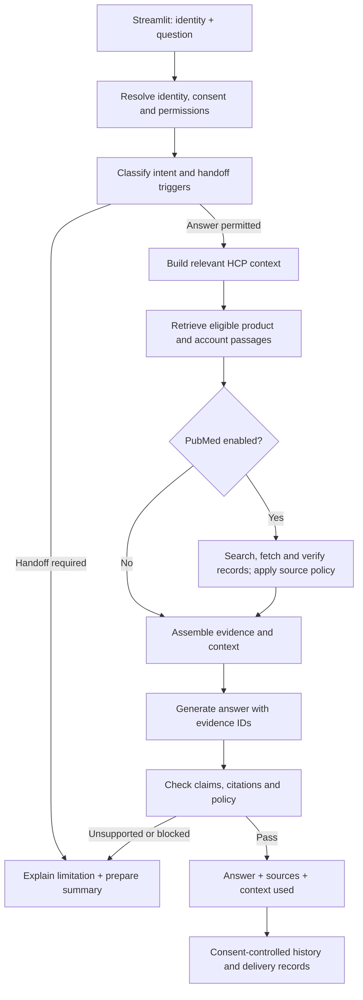
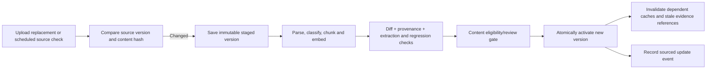

# CAMZYOS Germany contextual chatbot — implementation specification

> Design/research record. See [implementation status](status.md) for what is now built, tested and still limited.

Updated 30 October 2026 from the user's consolidated requirements, the supplied workbook and the inspected PDF folder. This document defines the intended implementation and acceptance checks; it is not a report of a completed chatbot or measured performance.

**Product scope**

A text chatbot for HCP questions about CAMZYOS in Germany. It combines relevant personal context with eligible product and account evidence, displays the context and sources used, and prepares human handoffs when required. No voice, avatars, patient treatment recommendations or autonomous external messaging.

Reuse Streamlit for the interface, Python for the controlled workflow, Neo4j for structured relationships and document retrieval, Graphiti for attributed temporal interaction memory, and RAGAS plus custom evaluations. Graphiti is a memory/retrieval component, not the authority for clinical facts. Import known workbook fields directly. The official sales-agent example is a reference implementation to adapt, not a production security boundary.

**Three information categories**

| Category | Content | Retrieval and use |
|---|---|---|
| HCP context | Specialty, experience, supplied demographics, practice setting, explicit communication preferences, relevant persona/personality fields, previous interactions, received materials, unresolved questions and consent | Load only the resolved HCP's records. Use relevant facts to adjust topic selection, detail, language and continuity. Do not infer competence or preferences from demographics or commercial influence scores. |
| Brand/product evidence | German/EU product information, eligible evidence summaries, trial publications, relevant journal material and explicit evidence gaps | Product claims require eligible document passages. Preserve jurisdiction, source category, version, audience, original wording and citation anchors. US FDA material remains excluded from default German answers. |
| Account/provider/payer context | Verified hospital/clinic policies, treatment pathways, local access arrangements and payer documents linked to the correct account | Require explicit account affiliation and permission. Distinguish local policy from product labelling. Do not infer a specific hospital policy from a general workplace type or city. |

Missing account evidence is a visible content gap. The reviewed workbook contains a general workplace field and synthetic local-market summaries; it does not establish verified hospital identities, their actual guidelines, or payer coverage for a particular person. Add an explicit account map and source documents when supplied. Synthetic placeholders must not be presented as real access policy.

**Runtime flow**



A bounded Python workflow is sufficient. LangGraph can express its states if useful; a free-running multi-agent architecture is unnecessary for the prototype.

**Identity, memory and personalization rules**

- For the synthetic demo, entering/selecting an email from HCP_Profile resolves to an HCP ID and greets the HCP by name. This demonstrates identity resolution, not secure production authentication. Production requires verified login before exposing profiles.
- Derive HCP ID, account scope and memory namespace in application code; neither user text nor a model tool argument may select another HCP's records. Apply this to retrieval, caches, session state, exports and handoff summaries.
- An unknown email gets approved, general German-market content with no personal history or restricted account context. Do not store the entered identity or conversation without consent.
- Consider the profile and history every turn, but include only relevant facts. A name in the greeting is not sufficient personalization. Do not repeat every past topic in every answer.
- Prioritize the current explicit request for this answer's style. A new request for a detailed explanation can override a stored concise preference for this turn. Persist a preference change only when it is intended and storage is allowed.
- Record contextual facts with source record IDs, timestamps and attribution. Distinguish HCP statements, rep notes, model summaries and verified document evidence. Conflicting or stale profile information should remain attributable instead of silently becoming certainty.
- General practice constraints or patient-population descriptions may shape relevance. A question seeking a treatment decision for an identifiable or individual patient must hand over even if names are removed.
- Concise answers must still retain essential qualifications and applicable safety information. Personalization changes presentation and relevance, not the factual claims supported by the sources.
- Do not automatically resend a material already delivered in the same version. The bot may still cite it or explain a relevant point when asked. A new version or explicit resend request is a separate event; track `source_id + version`, not just the title.

**Consent and logging**

The supplied `proactive_outbound_consent` field is not consent to persist new chats or derived memories. Represent conversation storage, memory persistence, proactive contact and sharing a handoff separately. If persistent storage is declined, use session-only context and avoid writing identifiable conversation text into logs. A minimal non-identifying operational record can still capture outcome counts. This resolves the tension between the workbook's audit-trail rule and the user's consent-before-storage requirement; the latter controls personal-data persistence.

Proactive updates default to off. Ingestion of a new source does not itself authorize contacting an HCP. A handoff is first prepared and displayed; no email or other external message is sent until the user elects to share it through a configured channel. The prototype may provide a copy/download action without an external messaging integration.

**Document and evidence storage**

Keep stable source identity separate from immutable source versions. Suggested entities:

`HCP`, `Account`, `Interaction`, `Consent`, `ContentDelivery`, `Source`, `SourceVersion`, `Chunk`, `EvidenceGap`, `Handoff`.

Explicit links connect the HCP to interactions, account affiliations and received source versions; source versions to chunks and predecessors; citations to the exact source version and page/section. Graphiti-generated memory should use a distinct schema/namespace from canonical workbook entities and authoritative document passages.

Each source version records provenance (supplied/public), publisher, original URL/path, product, jurisdiction, language, document type, intended audience by section, account scope, known publication/effective/expiry dates, review status, content hash and retrieval time. Regulatory documents without a printed expiry date remain subject to current/superseded status and review policy; do not invent expiry dates. Filesystem dates are not clinical effective dates.

Before retrieval, enforce product, jurisdiction, audience, account permissions, active version, validity and source eligibility. English EU product information can apply to Germany; English-language US labelling does not become German evidence. Institutional policy cannot extend the German authorised indication. A conflict between policies or sources should be surfaced and, where material to an answer, referred rather than silently blended.

The inspected corpus has seven PDFs/191 pages. Two are US prescribing documents. The EU product-information PDF contains both HCP and patient sections and decision diagrams. Preserve section boundaries, tables, footnotes, page anchors and original page images; verify clinically meaningful diagram extraction. Keep placeholder workbook chunks out of the factual index. See [document review](document-review.md).

**Optional PubMed search**

Expose a simple `PubMed search: Off / On` control, default off. Off means no live literature-search calls; previously reviewed and imported publications remain part of the local corpus. Explain this behavior next to the control.

When enabled:

1. Run intent and handoff checks first. Build a product/topic query without HCP identity, account details or individual patient information.
2. Use NCBI's structured E-utilities interface for search and record retrieval rather than treating a general search snippet as evidence.
3. Fetch actual records and supporting abstracts or accessible full text. Store PMID, supplied DOI if present, title, authors, journal, publication dates, canonical URL and retrieval timestamp. The model may select only IDs from this retrieved set; application code renders citation metadata and URLs.
4. Inspect available retraction, correction and expression-of-concern links and publication status. Do not assume every indexed item is a peer-reviewed clinical trial or relevant to the approved use.
5. Mark abstract-only evidence explicitly. Do not describe unaccessed methods, tables or full-text results as if read. A missing abstract or inaccessible full text limits what can be claimed.
6. Apply the configured source policy and on-label scope check. The safe default for this prototype is to use already reviewed public sources in answers and queue newly discovered, unreviewed articles for reviewer inspection. Public discovery is not automatic internal approval. A future explicitly authorized public-evidence policy can change that gate.
7. Check whether the cited text actually supports each claim. An existing PMID verifies a citation's identity, not the truth of every sentence attached to it. Unsupported claims are removed or the bot abstains/hands over.
8. Log search parameters, result IDs, exclusions and source contributions, subject to the consent boundaries. On timeout, report literature search unavailable and answer only from sufficient local evidence; do not call a failed search 'no evidence'.

NCBI identifies E-utilities as its public interface for search and retrieval across PubMed and related databases. PubMed distinguishes abstracts/full text and exposes links for corrections and retractions. [NCBI API overview](https://www.ncbi.nlm.nih.gov/home/develop/api/), [PubMed guide](https://pubmed.ncbi.nlm.nih.gov/help/).

**Document updates and reprocessing**



- Start with a manual 'check/reprocess sources' action plus replacement upload; scheduled polling can use the same function. A filesystem watcher is optional, not a requirement for the first iteration.
- Use stable source IDs and SHA-256 to detect changed bytes; preserve versions. ETag/Last-Modified can optimize remote checks but are not proof of unchanged meaning. A formatting-only update can be identified through normalized-text comparison.
- Reprocess the changed source, not all HCP profiles or the entire corpus. Reuse unchanged chunk embeddings only when extraction, chunking and embedding configurations also match; otherwise rebuild affected representations. Use idempotent jobs.
- Keep new chunks hidden while processing. Activate only a complete eligible version; concurrent questions use a consistent evidence snapshot. A failed job leaves the previous still-valid version active. If the old version is expired, withdrawn or known invalid, it must not remain eligible merely because its replacement failed.
- Invalidate answer/retrieval caches using corpus revision, source versions, account scope, HCP context revision, consent scope and search mode. Never reuse another HCP's cached answer.
- Revalidate historical assistant claims and summaries that point to superseded evidence; they remain historical records, not current clinical authority. A new answer retrieves current evidence rather than trusting an old conversation answer.
- Keep old source versions for permitted audit/reproduction. Historical answers retain their original citation IDs and as-of time; do not rewrite their provenance to point at a newer document.
- Generate 'what changed?' content from verified document differences, with old/new citations. Update activation does not trigger proactive delivery without consent. Re-run relevant evaluation cases before activation and allow rollback to a still-eligible version.

**Handoff behavior**

| Trigger | Response and destination |
|---|---|
| Off-label question | Decline the requested advice; prepare a Medical Information/MSL summary. |
| Individual patient decision | Decline individualized advice; offer MSL/Medical Information. |
| Unsupported comparison claim | Do not generate the claim; offer approved evidence and MSL discussion. The workbook's GR_05 is stricter and blocks comparative-claim generation generally, so default to that conservative setting. |
| Another HCP's information | Refuse disclosure without retrieving it. A handoff summary must not contain that other HCP's records. |
| Human explicitly requested | Prepare the requested handoff without requiring further chatbot troubleshooting. |
| Missing, conflicting or insufficient eligible evidence | State the specific limitation and offer a human. Retrieval similarity alone is not a clinical confidence score. |
| Adverse-event mention or product complaint | The supplied workbook also defines PV and Quality routes. Keep these distinct from ordinary rep follow-up, subject to the sponsor's actual intake procedure. Do not turn a synthetic workbook timing field into an asserted legal deadline. |

The summary contains the user's question, relevant permitted context, what has already been answered, exact sources/versions used, remaining uncertainty, trigger and intended recipient. Show the draft before sharing. A draft is not a sent referral.

**What the interface exposes**

Keep one chat page with HCP selection/email, a PubMed toggle and storage choice. Display the answer with expandable panels for sources, personal context used and limitations. Show an optional comparison view for evaluation. An admin/reviewer view can manage source versions, ingestion status, discovered PubMed candidates and evaluation results.

For each answer, retain an in-memory response record shaped approximately as:

```json
{
  "decision": "answer | clarify | handoff",
  "answer": "...",
  "context_used": [{"kind": "profile | interaction | account", "record_id": "...", "reason": "..."}],
  "citations": [{"source_id": "...", "version_id": "...", "chunk_id": "...", "page": 3, "section": "...", "pmid": null}],
  "limitations": [],
  "handoff": null,
  "corpus_revision": "...",
  "pubmed_mode": "off | on"
}
```

This is an illustrative contract, not an implemented schema. Citation checks establish ID membership and supporting passages; a generated citation string is never accepted merely because it looks plausible.

**Evaluation that matches the judging criteria**

Compare three modes on the same questions and model:

- A: generic model, without document tools or HCP context.
- B: eligible document RAG, without personalization context.
- C: the same eligible evidence access plus relevant HCP/account/history context.

Keep access controls and safety handling consistent. Keep model settings, output budgets, corpus snapshot and search setting fixed, and isolate sessions/memory so one run cannot teach another. B versus C isolates the benefit of personalization more fairly than A versus C alone. Treat PubMed-on/off as a separate controlled comparison, using recorded search snapshots for reproducibility. Label generic output as an evaluation baseline, not verified clinical guidance.

Apply retrieved-context metrics to modes with retrieval. For the generic baseline, mark context-faithfulness metrics not applicable rather than assigning a misleading score against an empty context; compare its factual accuracy using the same reviewed references and human rubric. Report ties and regressions as well as improvements.

| Judging criterion | Evidence to show |
|---|---|
| Grounded | Claim-to-passage support, valid citation IDs, correct source jurisdiction/version, RAGAS faithfulness/retrieval metrics, and handoff compliance. |
| Contextual | Relevant profile/history facts used; no invented personal facts; appropriate concise/detailed style; recognition of prior material and unresolved follow-ups. |
| Useful | Clinician/reviewer rubric for relevance, completeness, readability, preserved qualifications and appropriate escalation. Record latency/cost as secondary practical measures. |
| Learning value | A sourced gap log: missing account policy, unreviewed source, conflicting version, inaccessible full text, ambiguous profile, diagram extraction uncertainty and failed retrieval. |

RAGAS faithfulness measures consistency with retrieved context. It does not establish that the context is current, eligible, medically correct or appropriately personalized. Add deterministic eligibility/isolation checks and human review rather than interpreting a high score as clinical validation. [RAGAS definition](https://docs.ragas.io/en/stable/concepts/metrics/available_metrics/faithfulness/).

Suggested initial suite: the same four allowed question themes across all eight HCPs (32 contextual cases), plus the edge-case checks below. Freeze expected sources and contextual facts after review; do not fabricate clinical reference answers from the workbook placeholders.

| Acceptance case | Required observable outcome |
|---|---|
| Known email | Correct greeting, profile and only that HCP's interactions. |
| Unknown email | General approved-content mode, no account/personal disclosure or default persistence. |
| Concise versus detailed profiles | Different appropriate structure/detail with the same supported factual core. |
| Current request overrides style | A request for more detail changes this answer without silently rewriting persistent preferences. |
| Relevant prior meeting | The response uses the correct dated topic/open issue and displays its record ID. |
| Irrelevant personal history | Unrelated history does not distract from the current answer. |
| Already-received document | No automatic resend of the same version; citation and requested explanation remain available. |
| New version of a received document | New version is distinguishable; any delivery respects consent and is tracked separately. |
| Cross-user request or prompt injection | No foreign HCP records enter retrieval results, model context, cache result or handoff. |
| Storage declined | No new identifiable transcript or extracted-memory persistence. |
| Missing account policy | No invented institution rules or payer coverage. |
| General practice constraint | Relevant presentation without individual treatment advice. |
| Individual patient/off-label/comparison | Appropriate refusal and summary, with no prohibited recommendation. |
| Adverse event/product complaint/human request | Correct route; no ordinary sales response in place of required handling. |
| US source scores highly | Excluded before answer generation despite semantic relevance. |
| Expired, withdrawn or unreviewed source | Excluded; missing evidence is reported. |
| Placeholder paragraph appears in a search hit | Rejected as synthetic evidence. |
| PubMed off | No live literature call occurs. |
| PubMed on with valid eligible record | Only fetched citation metadata and supported text appear. |
| Missing PMID, mismatched claim or abstract-only record | No fabricated citation or unsupported full-text claim. |
| Retracted/corrected article or API failure | Appropriate exclusion/review or explicit availability limitation. |
| Changed PDF | New parsing job runs; old version remains auditable and new chunks are hidden until activation. |
| Failed replacement and invalid prior version | No answer quietly falls back to known-invalid evidence. |
| Update during a conversation | Subsequent answers retrieve a consistent active version; old assistant statements do not override it. |
| Unsupported question/evidence gap | Clear limitation and appropriate handoff, rather than a guessed completion. |

Treat zero observed cross-HCP disclosure and zero fabricated source IDs as required outcomes on this finite suite, not universal guarantees. Report actual results and failures; no quality improvements have yet been measured.

**Implementation order**

1. Deterministic workbook import, HCP context selection, source registry and curated German/EU evidence ingestion.
2. Grounded document answer with citations, followed by personalized answer using identical evidence access.
3. Consent-controlled history, guardrails, handoff draft and context/source displays.
4. Versioned reprocessing and stale-evidence tests.
5. Optional PubMed connector with policy checks and source contributions.
6. Reproducible comparisons, human review and content-gap reporting.

**Sources and research limitations**

The workbook supplied the HCP fields and guardrail rules; the user controls the requested scope. The seven supplied PDFs were inventoried in the linked document review. Technical sources consulted for this update were the NCBI API overview, PubMed help and RAGAS faithfulness documentation linked above. They contributed API selection, citation-status handling and evaluation semantics, respectively; none supplied a new clinical answer.

Fetch summary: `webcmd web fetch` succeeded for PubMed help and RAGAS documentation. The NCBI Bookshelf introduction was blocked; a second Bookshelf page through the web reader showed a browser challenge. The official NCBI API overview and PubMed help supplied the needed API information. No browser automation, live article-search benchmark, source activation or external handoff was performed.
